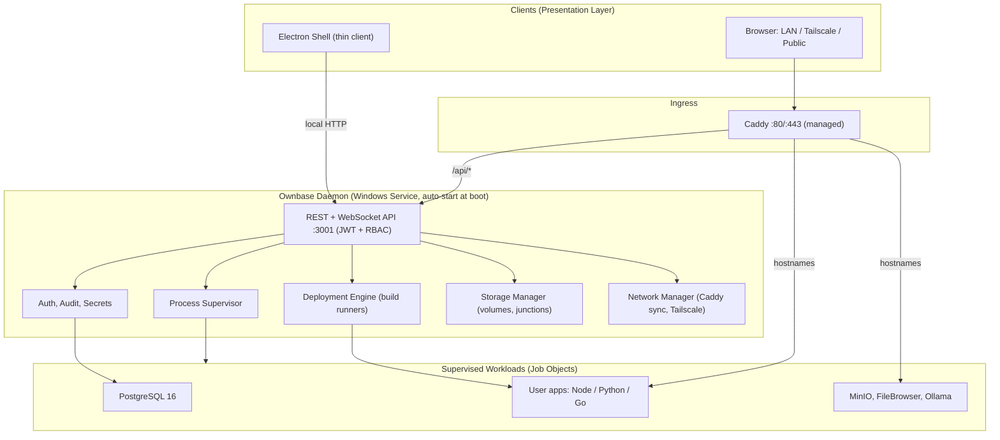
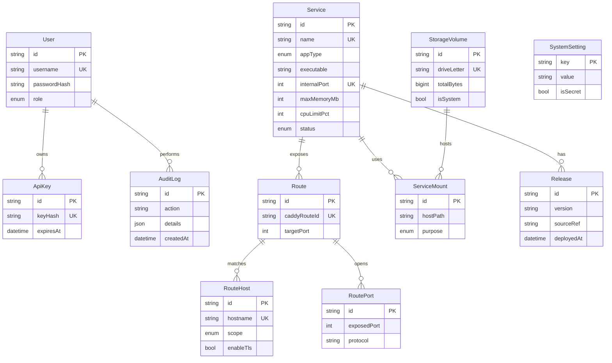

# PROJECT PROPOSAL

## Ownbase: A Secure, Headless, Virtualization-Free Self-Hosted Platform-as-a-Service for Windows

| | |
| :--- | :--- |
| **Degree** | B.Sc. in Computer Science & Engineering |
| **Project Type** | Software System (Desktop + Web + Background Service) |
| **Repository** | `github.com/rhmunna143/native-windows-server-prototype` (prototype, working name *Native Windows Server Hub*) |
| **Proposal Date** | 14 October 2026 |
| **Proposed Duration** | 16 weeks |

---

## 1. Abstract

Self-hosted platforms such as Coolify, CasaOS and 1Panel let individuals and small teams run their own cloud services, but all of them assume Linux and containers. On Windows they depend on Docker Desktop, WSL2 or Hyper-V, which adds a heavy memory footprint, licensing constraints and fragile networking.

**Ownbase** upgrades the author's own proof-of-concept prototype (*Native Windows Server Hub*) into a production-grade, **virtualization-free PaaS** that turns an ordinary Windows 10/11 PC into an always-on, remotely reachable server. The work centers on four engineering contributions:

1. A **headless Windows Service daemon** that decouples server uptime from the user interface.
2. A **security layer** with first-run provisioning, Argon2id password hashing, JWT authentication, role-based access control and encrypted secrets.
3. **Resource sandboxing** through Windows Job Objects (memory and CPU limits per application).
4. A **multi-language deployment engine** (Node.js, Python, Go) with dynamic Caddy routing, multi-drive storage and a web terminal.

The result is evaluated against measurable security, performance and reliability criteria.

---

## 2. Introduction and Background

Cloud hosting is expensive for hobbyists, students, and small businesses in regions with limited access to international payment methods, and many already own an idle Windows machine. Open-source panels exist, but they run services inside Linux containers. On Windows this means a hidden virtual machine layer, and any failure of the registry, hypervisor or virtual switch takes the whole server down.

The existing prototype demonstrates that a different approach is feasible: supervise **native Windows executables** directly on bare metal. It currently provides:

- An Electron 32 desktop shell and mobile-responsive Next.js 14 dashboard.
- Embedded portable PostgreSQL 16 managed through Prisma ORM 6.
- A process supervisor with tree termination (`taskkill /T /F`) and live log capture.
- Dynamic reverse proxying via the Caddy Admin API, with `nip.io` wildcard hostnames for LAN access.
- Tailscale (WireGuard) mesh access for remote use without port forwarding.
- A file manager with RFC 7233 byte-range streaming and a photo timeline.
- 24/7 persistence through tray minimization, login-item registration and `powerSaveBlocker`.

The prototype was built by the author specifically to test whether this approach is feasible. It proves the core idea, but a review of the implementation shows it is not yet safe or robust enough to expose beyond a trusted desk. This proposal defines the work needed to turn the proof of concept into the product, named **Ownbase**.

---

### 2.1 The Prototype as a Feasibility Study

The central question behind this project is: **can a self-hosted PaaS run reliably on bare-metal Windows without containers?** The prototype was built to answer it. The table records what it has already shown and what remains unproven; the unproven items are tested first in the schedule (Section 13, week 1).

| Hypothesis | Status | Evidence / next step |
| :--- | :-: | :--- |
| Native `.exe` workloads can be supervised with clean tree termination | Validated | Supervisor with `taskkill /T /F`; phase 2 verification script |
| PostgreSQL 16 can run portable and be managed through Prisma | Validated | `initdb` bootstrap and migration runner; phase 1 verification script |
| Caddy can be reconfigured with no downtime via its Admin API | Validated | `/load` sync with host-based routes; phase 3 verification script |
| Large video can be streamed to phones with range requests | Validated | RFC 7233 streamer in `fileManager.ts` |
| Tray, login item and power blocker keep the app alive | Validated in Electron | Superseded by the service design below |
| Tailscale gives remote access without port forwarding | Partly validated | CLI integration works; record an end-to-end test with a real auth key |
| The engine can run as a Windows Service before login (session 0) | **Unproven** | Spike: service wrapper, `%ProgramData%` paths, networking |
| Per-app memory and CPU limits can be enforced with Job Objects from Node | **Unproven** | Spike: FFI call (`koffi`) or small helper executable |
| Portable Python can build apps with `venv` and `pip` | **Unproven, plan needs a change** | The official *embeddable* Python zip does not include `pip` or `venv`. Use a full relocatable distribution (python-build-standalone or the NuGet `python` package) instead |
| A real PTY terminal works from Node on Windows | **Unproven** | Spike: `node-pty` (ConPTY) needs prebuilt or compiled native binaries |
| Public custom domains with automatic TLS work on home networks | **At risk** | ACME needs reachable ports 80/443; many home ISPs use CGNAT or block them. Fallback: Tailscale Funnel or a Cloudflare Tunnel |
| Unsigned or locally built binaries run under Smart App Control | **At risk** | Use signed official upstream binaries; keep `csc.exe` builds for tooling only |

**Conclusion of the feasibility review:** the plan is sound. The core mechanisms are already demonstrated. Four items need early spikes, and one design detail (embedded Python) must change before implementation. The one structural limit is isolation: Job Objects give resource caps, not the security boundary of a container, which is why Ownbase documents a "trusted workloads" model.

---

## 3. Problem Statement

### 3.1 Domain problem

Windows users who want to self-host applications have no lightweight, native, secure orchestration platform. Existing options impose virtualization overhead, licensing friction, and operational complexity.

### 3.2 Technical limitations identified in the prototype

These findings come from the author's review of the prototype source code. They are expected for a proof of concept and define the upgrade backlog.

| # | Area | Finding | Impact |
| :-: | :--- | :--- | :--- |
| P1 | Availability | Core engine runs inside the Electron main process. Closing or crashing the UI affects the server, and nothing starts before user login. | Not a true server |
| P2 | Authentication | REST API on `0.0.0.0:3001` has no authentication. Anyone on the LAN or Tailscale network can call it. | Critical |
| P3 | Injection | `POST /api/execute-query` runs raw SQL through `$queryRawUnsafe`. Combined with P2, this is unauthenticated remote database control. | Critical |
| P4 | Path traversal | `FileManager.safeResolve` removes `../` with a single regex pass and never verifies the resolved path stays inside the storage root. Inputs such as `....//` or an absolute path (`C:\...`) can escape it. Photo scanning also exposes absolute paths from the user's `Pictures` folder. | High |
| P5 | Secrets | Default credentials (`admin / admin12345678`) are hardcoded and displayed in the UI. The PostgreSQL cluster uses `trust` authentication. | High |
| P6 | Isolation | Supervised processes are spawned without CPU or memory limits. One runaway application can starve the host. | Medium |
| P7 | Extensibility | The service model is fixed to three binaries. There is no build pipeline for user applications, no runtime management, and no dynamic port allocator. | Feature gap |
| P8 | Fidelity | Bundled `filebrowser.exe`, `minio.exe` and `ollama.exe` are locally compiled C# stand-ins written to simulate the real services (static bucket lists, canned AI replies). | Not production-valid |
| P9 | Maintainability | Duplicate Prisma migration folders, duplicated route and URL-building logic across `caddy.ts`, `sync_caddy.js`, and several UI components, and an API contract maintained by hand in `openApiSpec.ts`. | Technical debt |
| P10 | Storage | A single `AppData` storage root. No awareness of multiple physical drives. | Feature gap |

---

## 4. Objectives

### 4.1 General Objective

To design, implement and evaluate a secure, headless, virtualization-free self-hosted PaaS for Windows 10/11 that supervises native workloads, isolates their resources, and exposes them safely over LAN, mesh VPN and the public internet.

### 4.2 Specific Objectives

| ID | Objective | Closes |
| :-: | :--- | :-: |
| O1 | Extract the engine into a Windows Service daemon that starts at boot and survives UI exit. | P1 |
| O2 | Implement first-run provisioning, Argon2id password hashing, short-lived JWT access tokens, API keys, and RBAC (`ROOT`, `ADMIN`, `OPERATOR`, `READ_ONLY`) on every REST and WebSocket endpoint. | P2, P5 |
| O3 | Remove raw-SQL execution from the public API; replace it with a read-only, role-gated query tool. Harden file path resolution with a canonical-root containment check. | P3, P4 |
| O4 | Enforce per-application memory and CPU limits using Windows Job Objects. | P6 |
| O5 | Build a deployment engine with portable Node.js, Python and Go runtimes, automated build steps, and dynamic port allocation. | P7 |
| O6 | Replace simulated services with real upstream binaries (MinIO, FileBrowser, Ollama), verified by checksum. | P8 |
| O7 | Detect Windows volumes and support tiered, multi-drive storage and multi-host ingress with automatic TLS. | P10 |
| O8 | Provide an authenticated web terminal (xterm.js + PTY) and a template catalog for one-click apps. | P7 |
| O9 | Generate the API contract and shared types from a single schema, and eliminate duplicated logic. | P9 |
| O10 | Test and evaluate security, performance, resource isolation and recovery behavior against defined metrics (Section 14). | all |

---

## 5. Scope

### 5.1 In scope

- Headless daemon, installer, and portable distribution for Windows 10/11 x64.
- Authentication, authorization, audit logging, and secret encryption.
- Process supervision, Job Object sandboxing, health checks and auto-restart policy.
- Deployment from Git repository or archive for Node.js, Python and Go applications.
- Reverse proxy management, multi-host routing, ACME TLS for custom domains, Tailscale integration.
- Multi-drive storage management and a catalog of installable service templates.
- Web dashboard (desktop and mobile), Electron shell as a thin client, web terminal.
- Automated test suite and evaluation report.

### 5.2 Out of scope

- Linux or macOS hosts, and container image support.
- Multi-node clustering and orchestration across several machines.
- Billing, multi-tenant customer accounts, or a public marketplace.
- Hardware-level isolation equivalent to a VM; sandboxing is limited to Job Objects, restricted tokens and filesystem permissions.

### 5.3 Limitations

- Isolation is weaker than containers. Applications run as Windows processes under the daemon's controlled account, not in separate kernels.
- Smart App Control and SmartScreen can block unsigned executables; code signing is documented but a paid certificate is outside the project budget.
- The evaluation uses one or two consumer PCs rather than a production data center.

---

## 6. Proposed System

The system is split into a **control plane** that always runs and a **presentation layer** that can come and go.



### 6.1 How the system solves the problems

| Problem | Design response |
| :--- | :--- |
| P1 | Daemon registered with the Service Control Manager, starting before login. Electron and browser are equal clients. |
| P2, P5 | Setup wizard appears only when no root account exists. Passwords hashed with Argon2id. A random 256-bit key (stored under DPAPI protection) encrypts third-party tokens and database passwords at rest. |
| P3, P4 | Raw SQL endpoint removed. All file access resolved by one function that checks `path.relative(root, resolved)` does not start with `..` and is not absolute. |
| P6 | Each application is assigned to a Job Object with `JOB_OBJECT_LIMIT_PROCESS_MEMORY` and CPU rate control. |
| P7 | Declarative app recipes (JSON) drive clone, build, run, health check and route registration. |
| P8 | Real binaries are downloaded, SHA-256 verified, and supervised unmodified. |
| P9 | One Zod schema set generates the OpenAPI document, TypeScript types and request validators. One `HostBuilder` module produces every URL and Caddy match. |

---

## 7. Major Modules and Features

| Module | Responsibilities | Key features |
| :--- | :--- | :--- |
| **M1. Identity and Access** | Users, sessions, API keys, roles | First-run wizard, Argon2id, JWT + refresh, RBAC, login throttling, audit log |
| **M2. Core Daemon** | Service lifecycle, configuration, logging | Windows Service install, crash recovery, config in `%ProgramData%` / portable `data\` |
| **M3. Process Supervisor** | Start, stop, restart, monitor | Job Object limits, restart backoff, health probes, log ring buffer, tree termination |
| **M4. Deployment Engine** | Source to running app | Git/zip intake, runtime resolver, build runners, port allocator (4000-4999), rollback to previous release |
| **M5. Ingress and Network** | Routing and remote access | Caddy config generator, multi-host routes (local, LAN, Tailscale, custom domain), ACME TLS, direct TCP listeners |
| **M6. Storage Manager** | Disks and data placement | Volume discovery, hot/cold tiering, NTFS junctions, MinIO multi-drive pools, quotas and usage reports |
| **M7. File and Media Services** | Files, photos | Contained path resolver, HTTP 206 streaming, upload, photo timeline |
| **M8. Web Terminal** | Operator shell | xterm.js over WebSocket, PTY-backed PowerShell, ROOT/ADMIN only, session audit |
| **M9. Catalog** | One-click apps | JSON recipes with checksum, version pin and default routes |
| **M10. Dashboard and Reports** | UI | Responsive Next.js UI, resource charts, alerts, audit and usage reports, exportable API docs |

---

## 8. Methodology

An **iterative, Agile (Scrum-lite)** approach is used with two-week sprints. The system already exists as a working prototype, so the project follows a refactor-and-harden strategy rather than a rewrite.

1. **Baseline assessment.** Freeze the prototype, record the findings in Section 3.2, and write failing tests that reproduce each security issue.
2. **Requirements and design.** Finalize requirements, threat model (STRIDE) and architecture.
3. **Incremental implementation.** Deliver in the order: security core, daemon extraction, sandboxing, deployment engine, storage and ingress, terminal and catalog.
4. **Continuous verification.** Unit, integration and end-to-end tests run in CI on every commit. Each sprint ends with a demo against the acceptance criteria.
5. **Evaluation.** Benchmarks and security tests (Section 14).
6. **Packaging and documentation.** Installer, portable build, user guide, API reference, final report.

---

## 9. Technologies and Tools

| Layer | Technology | Rationale |
| :--- | :--- | :--- |
| Daemon runtime | Node.js 20 LTS, TypeScript 5 | Reuses the existing engine code; strict typing |
| Service wrapper | WinSW or `node-windows` | Register Node as a Windows Service without custom C++ |
| Win32 access | `koffi` FFI, or a small helper executable that creates the Job Object and launches the target | Job Object limits and volume queries |
| API | Node `http` + lightweight router, Zod schemas, `ws` | Single schema source for validation and docs |
| Auth | `argon2`, `jose` (JWT) | Standard, audited libraries |
| Database | PostgreSQL 16 (portable), Prisma ORM 6 | Already integrated; relational model fits the domain |
| Proxy | Caddy 2.x (Admin API) | Automatic HTTPS, dynamic JSON config |
| Mesh VPN | Tailscale (WireGuard) | No port forwarding |
| Frontend | Next.js 14, React 18, Tailwind CSS, xterm.js | Existing UI, mobile responsive |
| Desktop shell | Electron 32 (thin client) | Tray and native window |
| Packaging | electron-builder (NSIS, portable) | Existing scripts |
| Testing | Vitest, Supertest, Playwright, k6 | Unit, API, UI and load testing |
| CI and VCS | Git, GitHub Actions (Windows runner) | Reproducible builds |
| Design / docs | Figma, Mermaid, OpenAPI 3.1 | Diagrams and contract generation |

---

## 10. System Architecture

The system follows a **layered client-server architecture** with a separate control plane.

```
Client (Browser / Electron)
        |
   Caddy ingress  (TLS, host routing)
        |
   Daemon API  (auth middleware -> validators -> services)
        |
   Domain services (Supervisor, Deploy, Storage, Network)
        |
   Persistence (PostgreSQL via Prisma) + OS (Job Objects, NTFS, SCM)
```

**Design rules (DRY and optimization):**

- One source of truth for API contracts (Zod), generating types, validation and OpenAPI.
- One `HostBuilder` function builds every hostname and URL; the proxy config, dashboard links and documentation all call it.
- One `PathGuard` function resolves every file path.
- One migration folder (`prisma/schema/migrations`), with the duplicate removed.
- Process state is pushed over a single WebSocket event stream instead of 8-second polling of eleven endpoints from the dashboard.

---

## 11. Database Design

The unified schema (multi-file Prisma) consolidates the current `Service` and `Route` models with the authentication, storage and settings models already sketched in the upgrade plan.



Notes:

- `isSecret` values and API-key material are stored encrypted or hashed, never in plaintext.
- `RouteHost.hostname` and `(exposedPort, protocol)` carry unique constraints to prevent conflicting routes.
- The daemon owns migrations; the migration runner resolves the Prisma CLI from the bundled package, not from `npx` at runtime.

---

## 12. Requirements

### 12.1 Functional requirements

| ID | Requirement |
| :-: | :--- |
| FR1 | The system shall start as a Windows Service at boot, before any user logs in. |
| FR2 | The system shall require creation of a root account at first launch and refuse all other API calls until then. |
| FR3 | The system shall authenticate every API and WebSocket request and enforce role permissions. |
| FR4 | The system shall record security-relevant actions (login, service control, deploy, terminal session) in an audit log. |
| FR5 | The system shall deploy a Node.js, Python or Go application from a Git URL or archive and start it on an allocated port. |
| FR6 | The system shall enforce configured memory and CPU limits on each application process tree. |
| FR7 | The system shall restart failed applications according to a configurable backoff policy. |
| FR8 | The system shall register and remove reverse-proxy routes without downtime, supporting several hostnames per application. |
| FR9 | The system shall obtain and renew TLS certificates automatically for custom domains. |
| FR10 | The system shall list Windows volumes and let an administrator assign storage paths per service. |
| FR11 | The system shall stream media with HTTP 206 range support and shall never serve a path outside its configured roots. |
| FR12 | The system shall provide an authenticated, audited web terminal limited to privileged roles. |
| FR13 | The system shall provide a catalog of installable service templates with verified checksums. |
| FR14 | The system shall generate its API documentation from the same schemas used for validation. |

### 12.2 Non-functional requirements

| Attribute | Measurable target |
| :--- | :--- |
| Security | No unauthenticated endpoint except health and first-run setup; zero path-traversal and SQL-injection findings in the test suite; OWASP ASVS Level 1 checklist satisfied |
| Reliability | Supervised app restarts within 10 s of crash; daemon recovers automatically after crash or reboot |
| Performance | API p95 latency under 100 ms for non-streaming calls on a mid-range PC; byte-range seek on a 4 GB video starts under 1 s on LAN |
| Resource efficiency | Idle daemon plus PostgreSQL plus Caddy under 500 MB RAM and under 2 % CPU |
| Isolation | An app configured for 512 MB is terminated or capped when exceeding it; host stays responsive |
| Usability | A new user reaches a running deployed app in under 10 minutes using only the UI |
| Maintainability | At least 80 % unit-test coverage on the auth, path guard and supervisor modules; no duplicated URL or host logic |
| Portability | Runs on Windows 10 22H2 and Windows 11 without Docker, WSL2 or Hyper-V enabled |

---

## 13. Project Plan and Timeline

| Weeks | Phase | Deliverables |
| :-: | :--- | :--- |
| 1 | Baseline assessment and feasibility spikes | Reproduction tests for P1-P10, threat model, final requirements; spikes for Windows Service, Job Objects, portable Python, PTY, Tailscale end-to-end |
| 2-3 | Security core (M1) | First-run wizard, Argon2id, JWT, RBAC, audit log, `PathGuard`, removal of raw SQL endpoint |
| 4-5 | Daemon extraction (M2) | Windows Service, thin Electron client, API over authenticated HTTP/WS, single migration folder |
| 6-7 | Supervisor and sandboxing (M3) | Job Object limits, restart policy, health probes, event stream |
| 8-10 | Deployment engine (M4, M9) | Runtime manager, build runners, port allocator, recipes, rollback |
| 11-12 | Ingress and storage (M5, M6) | `HostBuilder`, multi-host routes, ACME TLS, volume discovery, MinIO pooling |
| 13 | Web terminal and real services (M8, O6) | xterm.js terminal, verified upstream binaries |
| 14 | Integration and hardening | Full regression, security re-test, load test |
| 15 | Evaluation | Benchmarks, comparison with prototype baseline, results analysis |
| 16 | Packaging and documentation | Installer, portable build, user guide, final report and defense slides |

**Milestones:** M-A (week 3) secure API; M-B (week 5) headless daemon; M-C (week 10) end-to-end deploy; M-D (week 15) evaluation complete.

---

## 14. Evaluation Plan

| Goal | Method | Success criterion |
| :--- | :--- | :--- |
| Security | Automated tests for traversal, injection, broken auth and brute force; manual review against OWASP ASVS L1 | All baseline issues P2-P5 fixed; no critical or high findings remain |
| Isolation | Deploy a memory-hog and a CPU-spin app with limits | Limits enforced; other services stay within 10 % of baseline latency |
| Reliability | Kill the app, kill the daemon, reboot the host, run 72 h soak test | Auto-recovery in all cases; no zombie processes |
| Performance | k6 load tests on API and streaming endpoints | Targets in Section 12.2 met |
| Footprint | Measure idle RAM and CPU against a Docker Desktop + Portainer setup running the same workload | Native stack uses substantially less memory (reported with numbers) |
| Usability | Task-based test with 5 or more users (time to first deployed app, error count) | Median under 10 minutes |

---

## 15. Risk Analysis

| Risk | Likelihood | Impact | Mitigation |
| :--- | :-: | :-: | :--- |
| Smart App Control or SmartScreen blocks binaries | High | Medium | Use official signed upstream binaries; document signing; keep the `csc.exe` build path only for tooling |
| Job Object API complexity from Node | Medium | Medium | Prototype early (week 6); fall back to a small helper executable that creates the job and launches the target |
| Windows Service and desktop session differences (paths, networking, no GUI) | Medium | Medium | Service spike in week 1; store config in `%ProgramData%` |
| Embeddable Python lacks `pip` and `venv` | Certain | Medium | Ship a full relocatable Python distribution instead |
| `node-pty` native module fails to build or load | Medium | Low | Use prebuilt binaries; terminal is a stretch goal |
| Public TLS blocked by CGNAT or ISP port blocking | Medium | Medium | Default to Tailscale; offer Tailscale Funnel or Cloudflare Tunnel for public exposure |
| Public exposure of a home server | Medium | High | Default to Tailscale; require TLS and auth for any public route; show warnings in the UI |
| Scope too large for the schedule | Medium | High | Priorities fixed: M1, M2, M3 mandatory; M6 multi-drive and M8 terminal are stretch goals |
| Antivirus false positives on build tools | Low | Medium | Document exclusions; use portable runtimes from official sources with checksum verification |

---

## 16. Expected Outcomes

- A working headless PaaS for Windows with documented, tested security controls.
- Measured evidence that a native approach uses fewer resources than a container-based stack on the same hardware.
- A reusable, schema-driven codebase with the duplicated logic of the prototype removed.
- An installer and portable build, user guide, API reference, and final technical report.
- Demonstrated application of operating systems (processes, Job Objects, services), networking (reverse proxy, VPN, TLS), database, security and software engineering knowledge.

---

## 17. Conclusion

The Ownbase prototype shows that orchestrating native executables is a viable alternative to containers on Windows. This project turns the prototype into a system that can be trusted: authenticated, sandboxed, restart-safe, extensible and measurable. By decoupling the server from the UI, closing identified vulnerabilities, and adding a deployment engine, the platform becomes useful for students, freelancers and small businesses who need a private cloud without virtualization overhead, while giving the author a rigorous, evaluated piece of systems engineering.

---

## 18. References

1. R. Fielding, Y. Lafon, J. Reschke (eds.), "HTTP/1.1 Range Requests," RFC 7233, IETF, 2014.
2. M. Jones, J. Bradley, N. Sakimura, "JSON Web Token (JWT)," RFC 7519, IETF, 2015.
3. A. Biryukov, D. Dinu, D. Khovratovich, S. Josefsson, "Argon2 Memory-Hard Function for Password Hashing and Proof-of-Work Applications," RFC 9106, IETF, 2021.
4. J. A. Donenfeld, "WireGuard: Next Generation Kernel Network Tunnel," Proc. NDSS Symposium, 2017.
5. OWASP Foundation, "Application Security Verification Standard (ASVS) 4.0," 2019.
6. Microsoft, "Job Objects," Windows Win32 API documentation, Microsoft Learn.
7. Microsoft, "Windows Service Applications," Microsoft Learn.
8. Caddy Documentation, "Admin API and JSON Configuration," caddyserver.com/docs.
9. Prisma Documentation, "Multi-file Prisma schema and Migrate," prisma.io/docs.
10. Tailscale Documentation, "Auth keys and tailscale up," tailscale.com/kb.
11. Electron Documentation, "powerSaveBlocker and app.setLoginItemSettings," electronjs.org/docs.
12. PostgreSQL Global Development Group, "PostgreSQL 16 Documentation," postgresql.org/docs/16.

---

## Student Information

| | |
| :--- | :--- |
| **Name** | ______________________________ |
| **ID** | ______________________________ |
| **Department** | Computer Science & Engineering |

## Supervisor Information

| | |
| :--- | :--- |
| **Supervisor** | ______________________________ |
| **Designation** | ______________________________ |
| **Department** | Computer Science & Engineering |
| **Institution** | ______________________________ |
| **Signature** | ______________________________ |
| **Date** | ______________________________ |
