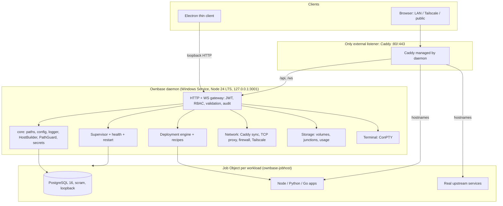
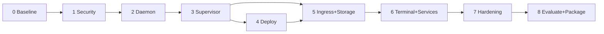

# UPGRADE_PRD.md — Ownbase (Native Windows Server Hub → Production PaaS)

| | |
| :--- | :--- |
| **Document** | Product Requirements Document, phase-by-phase upgrade plan |
| **Product** | Ownbase (prototype name: *Native Windows Server Hub*, repo `native-windows-server-prototype`) |
| **Version / Status** | 1.0 — Draft for supervisor review |
| **Date** | 16 October 2026 |
| **Companions** | `PROJECT_PROPOSAL.md` (academic scope, objectives O1–O10, findings P1–P10, requirements FR1–FR14), `upgrade-plan.md` (architecture log) |
| **Horizon** | 16 weeks, 9 phases (0–8), each ending at a gated, demo-able release |

---

## 1. Purpose and how to read this

The proposal says *what* and *why*. This PRD says *in what order, touching which files, and how we know each step is done*. Each phase has the same structure so it can be copied straight into a sprint board:

**Objective → Closes (P/O/FR ids) → Work items (files affected) → DRY and optimization rules → Acceptance criteria (testable) → Tests → Exit gate and rollback.**

Rules that apply to every phase:

1. **Test first for defects.** Every security or correctness finding gets a failing test before the fix (Phase 0 creates them).
2. **One source of truth.** No new logic is added if the same logic already exists elsewhere; duplicates are removed in the phase that touches them (Section 4).
3. **Additive migrations only** until Phase 8; every DB migration ships with a down-path note and a data-migration script for existing prototype installs.
4. **A phase is not done until its exit gate passes on a clean Windows 10 22H2 VM and a Windows 11 VM**, not only on the developer machine.
5. **Trusted-workload model.** Job Objects give resource caps, not a security boundary. This is stated in the UI and docs (proposal §5.3).

---

## 2. Baseline: what the code actually does today

Verified against the repository. These are the facts the phases are built on.

| Ref | Observation (file) | Phase that fixes it |
| :-: | :--- | :-: |
| P1 | Engine lives in the Electron main process; `src/main/index.ts` boots Postgres, supervisor, Caddy and the API only after `app.whenReady()`. | 2 |
| P2 | `httpServer.ts` listens on `0.0.0.0:3001` with `Access-Control-Allow-Origin: *` and no auth on any route. README also tells users to open ports 3001, 5432, 8080, 9000, 11434 to the LAN. | 1, 2 |
| P3 | `POST /api/execute-query` and the IPC `execute-query` call `$queryRawUnsafe(sql)` unauthenticated. | 1 |
| P4 | `FileManager.safeResolve` strips `../` in one regex pass (`....//` becomes `../`) and never checks containment. Photo items from `~/Pictures` carry **absolute** paths that `safeResolve` happily resolves, so `/api/files/stream?path=C:\any\file` reads arbitrary files. `serveStaticFile` joins `pathname` into `out/` without a containment check. | 1 |
| P5 | Default login `admin / admin12345678` hardcoded in `supervisor.ts`, `ServicesTable.tsx`, `DiagnosticsCard.tsx`, README. Postgres initialised with `-A trust`. Tailscale auth key is passed on the process command line. | 1, 2 |
| P6 | `spawn()` with no limits; `env` copies the whole parent environment into every service and sets `OLLAMA_HOST` on all of them; no restart policy (a crash is only labelled `crashed`). | 3 |
| P7 | Supervisor contains per-binary argument logic (`caddy run`, FileBrowser flags, MinIO flags); no build pipeline, runtimes, or port allocator. | 3, 4 |
| P8 | `filebrowser.exe`, `minio.exe`, `ollama.exe` are C# simulators in `scripts/*.cs` (static bucket list, canned AI replies, fake `users add`). | 6 |
| P9 | Duplicate migration trees (`prisma/migrations` and `prisma/schema/migrations`); URL/host building duplicated in `caddy.ts`, `scripts/sync_caddy.js`, `NetworkAccessCard`, `RoutesTable`, `ServicesTable`, `AppStore`; each endpoint is hand-mirrored in `httpServer.ts`, `ipc.ts`, `preload/index.ts`, `types.ts` (`ElectronAPI`), `apiClient.ts`, `openApiSpec.ts`; dashboard polls 11 endpoints every 8 s. | 0, 1, 3 |
| P10 | Single storage root in `AppData`. | 5 |

Additional defects found during review (not in the proposal; folded into the phases):

| Ref | Observation | Phase |
| :-: | :--- | :-: |
| P11 | `prisma.ts` runs `npx.cmd prisma migrate deploy` with `cwd = process.cwd()`. In a packaged app or a service the cwd is wrong and `npx` may not exist. On failure it silently falls back to `prisma db push`, which can alter the schema without a migration record. | 2 |
| P12 | `fileManager.saveFileBuffer` / `readRawBody` buffer the entire upload in memory (multi-GB videos will exhaust RAM). | 5 |
| P13 | `streamMedia` range parsing: suffix ranges (`bytes=-500`) yield `NaN`; an `end` past EOF returns 416 instead of being clamped; `Content-Disposition` uses `encodeURIComponent` inside quotes. | 5 |
| P14 | Photo timeline re-scans the whole storage tree synchronously on every request and serves full-size images as thumbnails; it also scans the user's `Pictures` folder without consent. | 5 |
| P15 | Logger keeps 500 entries in memory only; nothing is persisted or rotated. | 2 |
| P16 | `lifecycle.ts`, `postgres.ts`, `supervisor.ts`, `fileManager.ts`, `httpServer.ts` import `electron` for `app.getPath`. The engine cannot run without Electron until this is abstracted. | 2 |
| P17 | Stale PIDs stored in `services.pid` are never reconciled after a hard crash; Postgres stale `postmaster.pid` is deleted blindly. | 3 |

---

## 3. Target architecture and key decisions



### 3.1 Target source layout (no new repos; moves are mechanical)

```
src/
  shared/contract/     Zod schemas + route table (single source: types, validators, OpenAPI)
  daemon/
    core/              paths.ts config.ts logger.ts hostBuilder.ts pathGuard.ts secrets.ts events.ts
    auth/ supervisor/ deploy/ network/ storage/ terminal/ files/ db/
    main.ts            daemon entry (no electron import anywhere in src/daemon)
  electron/            thin client: window, tray, login-item, launches UI at the daemon URL
  app/ components/     Next.js UI (static export, served by the daemon)
tools/mocks/           the current C# simulators, kept only as CI fake upstreams
```

### 3.2 Decisions (ADR summary)

| ID | Decision | Why | Deviation from proposal |
| :-: | :--- | :--- | :--- |
| D1 | Daemon runs on a **bundled Node 24 LTS** (the same portable Node the deploy engine ships, reused) and is bundled with esbuild into one file. | Node 20 reached end of life in April 2026. Reuse removes a second Node copy. | Proposal says Node 20 LTS. |
| D2 | Service wrapper: **WinSW**. | Official, small, XML-configured, handles restart-on-failure. | none |
| D3 | The daemon binds **127.0.0.1:3001 only**. Caddy (:80/:443) is the single external listener. Inbound firewall allows only 80/443 (and explicitly exposed TCP ports). | Closes direct exposure of 3001/5432/8080/9000/11434. | Docs currently advertise `:3001` on the LAN; removed. |
| D4 | Job Objects via a **tiny launcher `ownbase-jobhost.exe`** (Go): create job, `CreateProcess` suspended, assign, resume. Spike S2 may substitute `koffi`. | `child_process.spawn` has no `CREATE_SUSPENDED`; assigning after spawn races with the child spawning grandchildren. Use `JOB_OBJECT_LIMIT_JOB_MEMORY` (whole tree), CPU hard cap, and `KILL_ON_JOB_CLOSE`. | Proposal names `PROCESS_MEMORY` (per process). Job-wide is the correct cap for a tree. |
| D5 | Store **routing intent**, derive hostnames. `Route` has `exposeLocal/exposeLan/exposeMesh`; `RouteHost` rows exist only for **custom domains**. `HostBuilder` generates `*.localhost`, `*.<lan-ip>.nip.io`, `*.<tailscale>.nip.io/ts.net` at sync time. | LAN IPs change with DHCP; stored nip.io hosts go stale. | Proposal ERD stores all scopes. |
| D6 | Postgres: `scram-sha-256`, `listen_addresses=127.0.0.1`, generated password held in encrypted config. | `trust` lets any local process own the DB. | none |
| D7 | Auth: Argon2id, JWT access token (15 min), rotating refresh token (httpOnly, SameSite=Strict cookie), API keys (random 32 bytes, SHA-256 stored), WS auth by one-time ticket. CORS allowlist, not `*`. | Browsers cannot set headers on WebSocket. | none |
| D8 | First-run setup is allowed **only from loopback or with a one-time setup token** written to a file readable by Administrators. | Prevents "first visitor on the LAN becomes ROOT". | Added. |
| D9 | Public exposure default: **Tailscale** (including `ts.net` certificates and Funnel). Custom-domain ACME is optional and warns about CGNAT. DNS-01 requires a custom Caddy build, so it is a Could. | ISP port blocking is common. | none (clarifies) |
| D10 | Raw TCP exposure uses a **daemon-native allow-listed TCP forwarder**, off by default, not the Caddy layer4 plugin. | Avoids a custom Caddy build. | Implementation choice. |
| D11 | Web terminal cannot be "restricted to project directories" (a PowerShell session can `cd` anywhere). Control is: ROOT-only by default, runs under the low-privilege service account with ACL-limited data, idle timeout, full session audit. | Honest threat model. | Upgrade-plan §3.4 claim is withdrawn. |
| D12 | Real service binaries come from official releases with pinned SHA-256 in `runtimes.manifest.json`. **Verify at implementation:** MinIO's community-edition binary distribution and licence (AGPLv3) have changed recently; if no official Windows binary is available, build from source with the managed Go toolchain or swap in another S3-compatible server. | Supply-chain and licence risk. | Added risk. |
| D13 | MinIO multi-drive mode is **erasure coding for redundancy** (needs several drives per set), not capacity pooling. For two ordinary disks use bucket-to-volume placement or one instance per volume. | Plan `minio.exe server D:\ E:\` would not behave as a pooled disk. | Corrects upgrade-plan §4.1. |
| D14 | Toolchain refresh: supported Electron major (32 is out of support), review Next.js 14 support status, move `package.json#prisma` to `prisma.config.ts` (deprecated key). | Security patches. | Added. |

---

## 4. DRY register (what is merged, where, and in which phase)

| Duplicated today | Single replacement | Phase |
| :--- | :--- | :-: |
| Two migration folders | `prisma/schema/migrations` only (matches `package.json#prisma.schema`) | 0 |
| API shape in `httpServer.ts`, `ipc.ts`, `preload`, `types.ts`, `apiClient.ts`, `openApiSpec.ts` | `shared/contract` route table; server, client, types and OpenAPI generated from it | 1 (routes added), 2 (IPC removed) |
| Host/URL building in `caddy.ts`, `sync_caddy.js`, 4 UI components | `core/hostBuilder.ts`, exposed to UI via `GET /api/v1/network/urls` | 5 (UI consumes from 2) |
| Path handling in `fileManager.ts`, `httpServer.ts`, `filebrowser_server.cs` | `core/pathGuard.ts` | 1 |
| `app.getPath` calls in 5 files | `core/paths.ts` (service / portable / dev modes) | 2 |
| Per-binary args in `supervisor.ts` | `ServiceSpec` produced by recipes | 3, 4 |
| Default credentials in 4 UI/doc places | Removed; setup wizard | 1 |
| Polling 11 endpoints / 8 s | Single `/api/v1/events` WebSocket + initial snapshot | 3 |
| `verify-phase{1..5}.ts` ad-hoc scripts | Vitest integration suites | 0 onward |
| `sync_caddy.js` | Deleted (daemon owns Caddy config) | 5 |

---

## 5. Phase overview

| Phase | Weeks | Title | Primary outcome | Closes |
| :-: | :-: | :--- | :--- | :--- |
| 0 | 1 | Baseline, spikes, hygiene | Failing tests for every finding; go/no-go on 4 risky mechanisms | decisions |
| 1 | 2–3 | Security core | Authenticated, validated, audited API; no raw SQL; safe paths | P2 P3 P4 P5 · O2 O3 · FR2 FR3 FR4 |
| 2 | 4–5 | Headless daemon | Server survives UI exit and starts before login | P1 P11 P15 P16 · O1 · FR1 |
| 3 | 6–7 | Supervisor and sandboxing | Job Object limits, restart policy, health, event stream | P6 P17 · O4 · FR6 FR7 |
| 4 | 8–10 | Deployment engine and catalog | Git/zip to running app, rollback, recipes | P7 · O5 O8(catalog) · FR5 FR13 |
| 5 | 11–12 | Ingress, storage, media | Multi-host routing, TLS, volumes, fast safe media | P10 P12 P13 P14 · O7 · FR8 FR9 FR10 FR11 |
| 6 | 13 | Terminal and real services | ConPTY terminal; simulators replaced by upstream binaries | P8 · O6 O8 · FR12 |
| 7 | 14 | Integration and hardening | Full regression, security re-test, load, backups | O9 · all NFR |
| 8 | 15–16 | Evaluation, packaging, docs | Measured results, installer, final report | O10 |



**Priority (MoSCoW).** Must: Phases 0–3 and 7–8, plus Phase 4 pipeline. Should: Phase 5 routing/TLS/volumes, real service binaries (Phase 6). Could: terminal, DNS-01, webhooks, Next.js upgrade. Cut order if the schedule slips: terminal, multi-drive tiering, TCP forwarder, DNS-01, catalog breadth.

---

## Phase 0 — Baseline, spikes, hygiene (Week 1)

**Objective.** Freeze the prototype as a measured baseline, prove or kill the four risky mechanisms before building on them, and clean the repo so later diffs are small.

**Closes.** Nothing in production; produces the test and decision inputs for everything else.

### Work items

| # | Item | Files / output |
| :-: | :--- | :--- |
| 0.1 | Tag `v0.1.0-prototype`; create `docs/baseline/` with idle RAM/CPU, start-up time, and API latency measurements of the current build (needed for Phase 8 comparison). | `docs/baseline/*.md` |
| 0.2 | Write **failing** Vitest tests reproducing P2, P3, P4, P5 (see Tests). | `tests/security/*.test.ts` |
| 0.3 | Delete `prisma/migrations/` (duplicate); keep `prisma/schema/migrations/`; verify `migrate deploy` on an empty DB. | `prisma/` |
| 0.4 | Add CI (GitHub Actions, `windows-latest`): install, `tsc` for both configs, Next build, Vitest, `npm audit`. | `.github/workflows/ci.yml` |
| 0.5 | Dependency baseline (D14): choose supported Electron, check `npm audit`, list all native modules (argon2, node-pty, koffi, sharp) and their Windows prebuilds. | `docs/baseline/deps.md` |
| 0.6 | Convert `scripts/verify-phase1..5.ts` into Vitest integration tests (same assertions); delete the scripts afterward. | `tests/integration/` |
| 0.7 | Threat model (STRIDE) for: API, file service, terminal, deploy pipeline, ingress. One page each, with trust boundaries. | `docs/threat-model.md` |
| 0.8 | Move C# simulators to `tools/mocks/` and remove them from `package.json` build and `electron-builder.json`. | `tools/mocks/` |

### Spikes (timebox 2 working days total per spike; each ends with a written pass/fail)

| Spike | Question | Pass criterion | Fail fallback |
| :-: | :--- | :--- | :--- |
| S1 | Does a WinSW-hosted Node process start before login, read `%ProgramData%`, bind loopback, and reach Postgres? | Reboot VM, probe API from another host before anyone logs in. | Scheduled task at boot as SYSTEM (weaker restart semantics). |
| S2 | Can a Job Object cap a process **tree** (memory and CPU) from the Go launcher, and does `KILL_ON_JOB_CLOSE` remove orphans when the daemon is killed? | 512 MB cap stops a memory-hog child of a child; killing the daemon leaves zero processes. | `koffi` FFI with assign-after-spawn plus periodic tree sweep. |
| S3 | Does `node-pty` (ConPTY) load on the chosen Node in a service context? | Interactive PowerShell over a socket. | Terminal moves to Could/cut. |
| S4 | End-to-end Tailscale: auth key join, `ts.net` HTTPS certificate via Caddy, access from a phone on cellular. | Documented working transcript. | Document manual join; skip auto-cert. |
| S5 | Python build: `python-build-standalone` (install_only) can create a venv and `pip install`; embeddable zip cannot. | `pip install requests` works in a relocated folder. | Use the NuGet `python` package. |

### Acceptance criteria
- A1: CI green on a clean clone; all new security tests **fail** for the expected reasons (red-first).
- A2: Baseline numbers recorded and reproducible by script.
- A3: Each spike has a decision recorded in `docs/adr/` and any changed decision updates Section 3.2 of this PRD.

### Exit gate and rollback
Supervisor sign-off on spike outcomes. Nothing user-visible ships, so rollback is `git revert`.

---

## Phase 1 — Security core (Weeks 2–3)

**Objective.** No unauthenticated action, no raw SQL, no path escape, no default credentials. Done **inside the existing process** first so the security work is not blocked by the daemon split.

**Closes.** P2, P3, P4, P5 · O2, O3 · FR2, FR3, FR4 · milestone M-A.

### Work items

| # | Item | Files / output |
| :-: | :--- | :--- |
| 1.1 | **Contract layer.** Create `shared/contract` with Zod schemas and a route table: `{ method, path, auth: 'public'\|'user', minRole, request, response, audit? }`. A small router in the API server reads this table; **a route not in the table does not exist**. | `src/shared/contract/*`, `httpServer.ts` refactor |
| 1.2 | **Schema.** Add `User`, `ApiKey`, `AuditLog`(v2), `SystemSetting`, `RefreshToken`; `Role` enum (`ROOT, ADMIN, OPERATOR, READ_ONLY`). Reconcile with the existing `system_configs` (migrate rows, then drop). | `prisma/schema/auth.prisma`, `settings.prisma`, migration |
| 1.3 | **First-run provisioning (D8).** `GET /api/v1/setup/status` (public), `POST /api/v1/setup` accepted only when no ROOT exists **and** (loopback request or valid setup token). Generates the 256-bit data key and Postgres password (stored via `core/secrets`). | `auth/setup.ts` |
| 1.4 | **Password and tokens (D7).** Argon2id (start m=64 MiB, t=3, p=1; tune to about 250–500 ms on target PCs and record in ADR), `jose` JWT, refresh rotation with reuse detection, API keys, logout/revocation. | `auth/*` |
| 1.5 | **Login protection.** Per-IP and per-username throttle with exponential delay; cap concurrent hash operations so login cannot be used for CPU exhaustion. | `auth/throttle.ts` |
| 1.6 | **RBAC guard.** Matrix (Section 10) enforced centrally from the route table; no handler does its own role check. WebSocket upgrade requires a ticket from `POST /api/v1/auth/ws-ticket`. | `auth/guard.ts` |
| 1.7 | **Remove raw SQL.** Delete `/api/execute-query`, IPC `execute-query`, and the `DatabaseCard` free-text console. Replace with a **read-only, ADMIN+ "table browser"**: allow-listed tables, pagination, runs inside `BEGIN READ ONLY` with a statement timeout. | `db/browser.ts`, `DatabaseCard.tsx` |
| 1.8 | **`core/pathGuard.ts`.** One function: resolve against a root, reject if absolute input, reject if `path.relative(root, resolved)` starts with `..` or is absolute, reject reserved Windows names and alternate data streams (`:`), and re-check after `realpath` to defeat junction/symlink escape. Used by `fileManager`, static server, uploads, deploy archives. Photos from external folders become **explicit admin-configured library roots**, addressed as `rootId + relative path`, never absolute. | `core/pathGuard.ts` |
| 1.9 | **Secrets.** `core/secrets.ts`: AES-256-GCM with the data key; key protected by DPAPI (LocalMachine scope for the service, spike S1) with ACL-restricted key file as fallback. Tailscale key passed via stdin or env, not argv. | `core/secrets.ts`, `tailscale.ts` |
| 1.10 | **Remove default credentials** from UI, README, supervisor; FileBrowser bootstrap (Phase 6) creates the admin from the setup wizard. | UI + docs |
| 1.11 | **Audit log.** Auth events, setup, user/role changes, service control, route changes, file delete, key creation. Append-only API; never logs secrets or request bodies of auth routes. | `auth/audit.ts` |
| 1.12 | **HTTP hardening.** CORS allowlist from config; security headers (`X-Content-Type-Options`, `Referrer-Policy`, CSP for the dashboard); 1 MB JSON body limit (uploads exempt); generic error bodies (no stack/SQL text). | gateway |
| 1.13 | **UI.** Login page, setup wizard, token store in memory (refresh via cookie), 401 handling, user and API-key management page, role-aware nav. | `app/`, `components/` |
| 1.14 | Version the API: `/api/v1/...`; keep no unversioned aliases. | contract |

### DRY and optimization
- Auth and validation run once, in the router, from the route table.
- OpenAPI is generated from the table (replaces hand-written `openApiSpec.ts`; delete it).
- Hash only on login; request authentication is JWT verification (microseconds).

### Acceptance criteria
- A1: Every route not marked `public` returns 401 without a token and 403 below its `minRole` (table-driven test over the whole route table).
- A2: Only `/health`, `/setup/status`, `/setup` (guarded), `/auth/login`, `/auth/refresh` are public.
- A3: Path fuzz corpus (`....//`, `..\`, `%2e%2e`, `C:\`, `\\server\share`, `file.txt::$DATA`, `CON`, junction pointing outside root) all rejected; zero escapes in 10 000 generated cases.
- A4: No endpoint accepts SQL text; table browser cannot write (attempted `DELETE` fails).
- A5: `grep` finds no `admin12345678` in the repo.
- A6: Brute-force test: 20 wrong logins in a minute leads to delay or lock; correct login still works for another user.
- A7: Phase 0 red tests are green.

### Tests
Vitest + Supertest (route-table-driven auth matrix); property-based path fuzz (`fast-check`); token tests (expiry, rotation, reuse detection, revoked key).

### Exit gate and rollback
Milestone **M-A** demo: attempt each baseline exploit live and show it blocked. Rollback: DB migrations are additive; revert the release tag. Existing prototype installs hit the setup wizard on first launch (documented, expected).

---

## Phase 2 — Headless daemon (Weeks 4–5)

**Objective.** The server is a Windows Service that starts at boot and keeps running when the UI is closed. Electron and the browser are equal clients.

**Closes.** P1, P11, P15, P16 · O1 · FR1 · milestone M-B.

### Work items

| # | Item | Files / output |
| :-: | :--- | :--- |
| 2.1 | **`core/paths.ts`** resolving three modes: *service* `%ProgramData%\Ownbase`, *portable* `<exe>\data`, *dev* `./.data`. Single place for data, logs, runtimes, apps, releases, backups. Fixes the `userData` name change from the brand rename: on first run, migrate `%APPDATA%\native-windows-server-hub` into the new tree. | `core/paths.ts` |
| 2.2 | **Remove every `electron` import from `src/daemon`** (P16): `postgres.ts`, `supervisor.ts`, `fileManager.ts`, `httpServer.ts`. Lint rule `no-restricted-imports` enforces it. | `src/daemon/**` |
| 2.3 | **Logger.** Replace the in-memory logger with structured JSON logs, rotating files, an event-bus subscriber for the UI, and secret redaction (P15). | `core/logger.ts` |
| 2.4 | **Config.** `config.json` (non-secret) plus encrypted secrets; schema-validated at start; defaults documented. | `core/config.ts` |
| 2.5 | **Migration runner fix (P11).** Run the bundled Prisma CLI by absolute path with `process.execPath`; set `DATABASE_URL` explicitly; **remove the `db push` fallback** (fail loudly, keep the service up in "degraded" mode with a clear error). | `db/migrate.ts` |
| 2.6 | **Postgres hardening (D6).** `scram-sha-256`, loopback only, generated password, safe stale-lock handling (check the PID in `postmaster.pid` is not alive and not Postgres before removing). | `db/postgres.ts` |
| 2.7 | **Service packaging.** WinSW config (recovery: restart on failure 3 times then every 60 s, delayed auto-start), install and uninstall commands, virtual service account `NT SERVICE\Ownbase` with ACLs on its data directory. | `installer/winsw/*`, NSIS script |
| 2.8 | **Firewall (D3).** Installer creates only inbound 80/443 rules (profile: Private by default); removes the README advice to open 3001/5432/8080/9000/11434. | NSIS script |
| 2.9 | **Power.** Service holds `SetThreadExecutionState(ES_SYSTEM_REQUIRED)` (via the Job helper or `koffi`); installer offers (with consent) `powercfg` changes for sleep and lid-close actions; UI shows current power-plan state read-only. | `core/power.ts` |
| 2.10 | **Electron thin client.** Loads the daemon URL, keeps tray and login-item, shows "service stopped" with a start button (UAC prompt), removes all IPC handlers except window/tray controls. Quit closes the window, **not** the server. Delete `ipc.ts` engine handlers and `preload` engine API (contract client replaces them). | `src/electron/*` |
| 2.11 | **Daemon serves the UI.** Static `out/` served by the daemon with `PathGuard`, long-cache for `_next/static`, SPA fallback. Remove the `getApiUrl` port-3000 special case. | gateway |
| 2.12 | **Portable mode.** Same daemon started as a hidden child of the portable exe; clearly documented as "no pre-login start". | `src/electron/portable.ts` |
| 2.13 | **Boot orchestration.** Daemon start order: paths, config, secrets, Postgres, migrate, gateway (API available early in degraded mode), supervisor, Caddy, Tailscale. Readiness endpoint reports each step (replaces `BootstrapStepper` data source). | `main.ts` |

### DRY and optimization
- One `paths.ts`, one logger, one config loader for daemon, tests, and tooling.
- Lazy-start non-critical modules (photos index, Tailscale) after the gateway is listening, so the API is reachable in seconds.

### Acceptance criteria
- A1: Close Electron, kill the browser tab: API and all services stay up (probe from another PC).
- A2: Reboot the VM and do **not** log in: `/health` answers within 60 s from another host; Caddy and Postgres are running.
- A3: `Stop-Process` on the daemon: WinSW restarts it within 10 s; no duplicate Postgres.
- A4: Port scan from the LAN shows only 80 and 443 open; 3001, 5432 and service ports closed.
- A5: Migration failure leaves the service running in degraded mode and logs the cause (no silent `db push`).
- A6: Existing prototype data migrates (services, routes, config) with no loss.
- A7: Idle memory of daemon + Postgres + Caddy under 500 MB, CPU under 2 % (NFR baseline check).

### Tests
Windows VM integration (PowerShell + Pester) for service lifecycle and reboot; port-scan test; migration-from-prototype fixture test.

### Exit gate and rollback
Milestone **M-B** demo on a freshly imaged VM. Rollback: installer keeps the previous version and data directory backup (`backups/pre-upgrade-<ts>`); uninstall removes the service cleanly.

---

## Phase 3 — Supervisor and sandboxing (Weeks 6–7)

**Objective.** Every workload runs inside a Job Object with resource limits, a restart policy and health checks, and state flows to the UI over one event stream.

**Closes.** P6, P17 · O4 · FR6, FR7 · part of P9.

### Work items

| # | Item | Files / output |
| :-: | :--- | :--- |
| 3.1 | **`ServiceSpec`** (command, args, cwd, env allowlist, port, health probe, limits, stop behaviour). The supervisor only consumes specs; all binary-specific knowledge moves out of `supervisor.ts` (initially into `recipes/builtin/*.ts`, user recipes in Phase 4). | `supervisor/spec.ts` |
| 3.2 | **State machine:** `stopped → starting → running → stopping`, plus `backoff`, `crashed`, `failed`. Transitions are the only way status changes; each emits an event. | `supervisor/machine.ts` |
| 3.3 | **Launcher + Job Objects (D4).** `ownbase-jobhost.exe` creates the job, applies limits (`JOB_MEMORY`, CPU hard cap, `KILL_ON_JOB_CLOSE`, optional active-process limit), starts the target suspended, resumes, and reports exit code and limit-violation events on a pipe. | `tools/jobhost/` (Go), `supervisor/jobhost.ts` |
| 3.4 | **Restart policy.** `always`, `on-failure`, `never`; exponential backoff 1 s to 60 s with jitter; crash-loop breaker (for example 5 crashes in 5 min leads to `failed` and an alert). | `supervisor/restart.ts` |
| 3.5 | **Health probes.** TCP or HTTP, start period, interval, failure threshold; route activation (Phase 5) waits for the first success. | `supervisor/health.ts` |
| 3.6 | **Graceful stop.** Ask the process to exit (job host sends Ctrl-Break or closes the console), wait the configured grace period, then terminate the job. Replaces `taskkill /T /F` as the primary path. | `supervisor/stop.ts` |
| 3.7 | **Environment isolation.** Build env from an allowlist plus the service's own variables; no more spreading `process.env` or global `OLLAMA_HOST`. Secret variables decrypted only at spawn. | `supervisor/env.ts` |
| 3.8 | **Reconcile on start (P17).** For each `RUNNING` row, verify PID *and* process creation time; adopt or kill; clear stale rows. Postgres and Caddy are supervised through the same path. | `supervisor/reconcile.ts` |
| 3.9 | **Logs.** Per-service ring buffer plus rotating file; streamed via events; size caps. | `supervisor/logs.ts` |
| 3.10 | **Metrics.** CPU and memory per job (Job accounting counters), sampled every 5 s into a short in-memory series (and 24 h downsampled in DB). | `supervisor/metrics.ts` |
| 3.11 | **Event stream.** `GET /api/v1/events` (WebSocket, ticket auth): `service.status`, `service.log`, `metrics`, `system.health`, `audit`. Initial snapshot endpoint. | `gateway/events.ts` |
| 3.12 | **UI.** Replace the 8 s polling with the stream; resource gauges, limit editors (memory MB, CPU %), restart-policy selector, crash-loop badges; "Trusted workloads" notice. | `app/page.tsx`, components |
| 3.13 | **Schema.** Add `maxMemoryMb`, `cpuLimitPct`, `restartPolicy`, `healthProbe`, `envVars`(encrypted) to `Service`; convert `type` to `AppType` enum plus `templateId` (data-migrate `caddy/filebrowser/ollama/minio` to `NATIVE_BINARY` + `templateId`). | migration |

### DRY and optimization
- One supervision code path for **everything** (Postgres, Caddy, services, apps, build jobs).
- Push events instead of polling: removes about 11 requests per 8 s per open dashboard.
- Metrics from job counters avoid spawning `tasklist`/`wmic`.

### Acceptance criteria
- A1: App limited to 512 MB that allocates 1 GB is terminated or capped; other services' API latency stays within 10 % of baseline.
- A2: CPU-spin app limited to 25 % stays at or under about 25 % of one core's share as configured (tolerance documented) while the dashboard stays responsive.
- A3: Kill the daemon with `taskkill /F`: **zero** workload processes remain (job kill-on-close).
- A4: A crashing app restarts within 10 s (first attempt); a crash loop stops after the configured threshold and raises an alert.
- A5: Reboot with stale `services.pid` rows: reconcile leaves a consistent state, with no PID-reuse kills of unrelated processes.
- A6: Dashboard network panel shows one WebSocket and no periodic polling.
- A7: `supervisor.ts` contains no binary names.

### Tests
Integration with purpose-built fixtures (memory-hog, cpu-spin, crash-N-times, spawn-grandchild, ignore-SIGINT); soak start (24 h) with random kills.

### Exit gate and rollback
Isolation demo (A1–A3) and the 24 h start of the 72 h soak. Rollback: feature flag `supervisor.jobObjects=false` falls back to plain spawn with the tree-kill sweep (documented as degraded).

---

## Phase 4 — Deployment engine and catalog (Weeks 8–10)

**Objective.** From a Git URL or archive to a running, routed, health-checked app, with zero-downtime promote and rollback. Catalog recipes make common services one-click.

**Closes.** P7 · O5, O8 (catalog) · FR5, FR13 · milestone M-C.

### Work items

| # | Item | Files / output |
| :-: | :--- | :--- |
| 4.1 | **Runtime manager.** `runtimes.manifest.json` pins Node, Python (python-build-standalone), Go, MinGit with URL and SHA-256 (hashes filled in at implementation, never copied from memory). Download, verify, extract with `tar` into `runtimes/<name>-<ver>/`; refuse on mismatch; reuse the daemon's own Node. | `deploy/runtimes.ts` |
| 4.2 | **Source intake.** Git clone (MinGit, depth 1, optional branch/tag, deploy key stored encrypted) and zip/tar upload. **Archive extraction uses `PathGuard`** against zip-slip, size and file-count limits. | `deploy/source.ts` |
| 4.3 | **Detector + recipe resolver.** Infer runtime and commands from `package.json`, `requirements.txt`/`pyproject.toml`, `go.mod`; allow override via an `ownbase.json` in the repo or UI fields (build command, start command, health path). | `deploy/detect.ts` |
| 4.4 | **Build runners** as supervised short-lived jobs (same Job Object path, timeout, memory cap, streamed logs): Node (`npm ci` or `install`, `build`), Python (`venv`, `pip install -r`, optional migrate), Go (`go build -o app.exe`). Build env isolated; secrets available only if the user marks them "build-time". | `deploy/build/*.ts` |
| 4.5 | **Port allocator.** 4000–4999; check with a real bind probe **and** DB unique constraint in one transaction; ports released on delete. | `deploy/ports.ts` |
| 4.6 | **Releases and promote.** Each deploy creates `Release` (`apps/<id>/releases/<n>`); start the new release on a fresh port, wait for health, switch the Caddy upstream, drain and stop the old one, keep last N (default 3). `Rollback` = promote a previous release. | `deploy/release.ts`, `Release` model |
| 4.7 | **Pipeline states and API.** `queued → fetching → building → starting → healthy → promoted` or `failed`; logs streamed via events; cancel supported; one deploy per app at a time. | contract + `deploy/pipeline.ts` |
| 4.8 | **Env and secrets UI.** Key/value editor with "secret" flag (write-only after save). | UI |
| 4.9 | **Catalog (M9).** JSON recipes validated by Zod: `id, name, version, source{url,sha256}, spec, defaultRoute, ports, docs`. Initial set: static site, Node app, Python app, Go app, Redis-compatible (Memurai or Redis build), plus placeholders for FileBrowser, MinIO, Ollama (finalised in Phase 6). Replaces the hard-coded `templates[]` in `AppStore.tsx`. | `catalog/*.json`, `AppStore.tsx` |
| 4.10 | **Optional:** webhook deploy trigger with HMAC verification (Could). | `deploy/webhook.ts` |

### DRY and optimization
- Deploy jobs and long-running services share `ServiceSpec`, supervisor and logging.
- Cache `node_modules`/pip wheels per app keyed by lockfile hash to cut rebuild time.
- Runtimes downloaded once and shared across apps.

### Acceptance criteria
- A1: Sample Node (Express), Python (FastAPI) and Go apps deploy from Git to a reachable hostname with no manual steps.
- A2: Failing build never touches the running release; UI shows the failing log.
- A3: Promote performs zero failed requests in a 30 s curl loop during the switch.
- A4: Rollback to the previous release completes in under 15 s.
- A5: Malicious archive (zip-slip, symlink, 10 GB bomb) rejected with a clear error.
- A6: Port allocator never hands out a port in use, including under 20 parallel deploys.
- A7: Runtime checksum mismatch aborts install.
- A8: New user reaches a deployed app in under 10 minutes (pilot with two testers).

### Tests
Pipeline integration with local Git fixtures; concurrency test for the allocator; archive fuzz; Playwright flow "deploy from UI".

### Exit gate and rollback
Milestone **M-C** (end-to-end deploy) demo. Rollback: per-app release rollback; engine disable flag leaves existing services unaffected.

---

## Phase 5 — Ingress, storage and media (Weeks 11–12)

**Objective.** Predictable multi-host routing and TLS, awareness of Windows volumes, and a media service that is fast and safe.

**Closes.** P10, P12, P13, P14 · O7 · FR8, FR9, FR10, FR11.

### Part A — Ingress and network

| # | Item | Files / output |
| :-: | :--- | :--- |
| 5.1 | **`core/hostBuilder.ts` (D5).** Input: route intent + current LAN/Tailscale addresses + custom domains. Output: Caddy matchers and the URL list the UI shows. Subscribes to network-change events (NIC/IP change) and re-syncs. | `core/hostBuilder.ts` |
| 5.2 | **Caddy config generator.** One function builds the full JSON; the daemon posts to `/load` only when the config **hash changes**; the config is persisted (autosave) so Caddy comes up correct after restart. Catch-all and `/api`, `/ws` routes owned here; delete `scripts/sync_caddy.js`. | `network/caddy.ts` |
| 5.3 | **Route model.** `Route` (+ `exposeLocal/Lan/Mesh`), `RouteHost` (custom domains only), `RoutePort`; unique constraints; migrate existing `subdomain`/`customDomain` rows. | migration |
| 5.4 | **TLS.** Custom domains via ACME HTTP-01/TLS-ALPN with a pre-flight check (port reachability, CGNAT hint, DNS points to this IP) and clear failure messages; Tailscale `ts.net` certificates when connected; DNS-01 left as Could (needs custom Caddy build). | `network/tls.ts` |
| 5.5 | **Direct TCP exposure (D10).** Daemon-native forwarder, allow-listed ports, off by default, ROOT/ADMIN only, audited; firewall rule created and removed with the listener and scoped to LocalSubnet/Tailscale by default. | `network/tcpProxy.ts`, `network/firewall.ts` |
| 5.6 | **Tailscale manager.** Status via `tailscale status --json`; auth key never on argv (1.9); peers list; Funnel toggle when available. | `network/tailscale.ts` |
| 5.7 | **UI.** Routes page rewritten to show derived URLs from `GET /api/v1/network/urls` (deletes URL building in `NetworkAccessCard`, `RoutesTable`, `ServicesTable`, `AppStore`); public-exposure warnings. | components |

### Part B — Storage

| # | Item | Files / output |
| :-: | :--- | :--- |
| 5.8 | **Volume discovery** (`Get-Volume ... \| ConvertTo-Json`, cached, refreshed on request and on device-change), `StorageVolume` sync; system-drive flag. | `storage/volumes.ts` |
| 5.9 | **Placement.** Per-service `ServiceMount` (purpose DATA/MEDIA/BACKUP/CACHE) validated by `PathGuard` roots; **junctions via `fs.symlink(target, path, 'junction')`** (no shell `mklink`); tiering defaults: Postgres and caches on the hot volume, media and backups on a chosen bulk volume. | `storage/placement.ts` |
| 5.10 | **Usage and quotas.** Cached usage scans (background, incremental); soft quotas enforced at upload (NTFS has no per-folder quota without FSRM); low-disk alerts at 90 %. MinIO handling per D13. | `storage/usage.ts` |

### Part C — File and media service

| # | Item | Files / output |
| :-: | :--- | :--- |
| 5.11 | **Streaming uploads (P12).** Pipe request to a temp file in the target volume, then atomic rename; size limits; resumable chunks (Could). | `files/upload.ts` |
| 5.12 | **Range handling (P13).** Parse single ranges per RFC 7233 including suffix ranges, clamp `end`, return 416 only when `start` is out of bounds, `Content-Disposition` with RFC 5987 `filename*`, `ETag`/`Last-Modified`, `If-Range`. Tests against a fixture file. | `files/stream.ts` |
| 5.13 | **Photo index (P14).** Background indexer stores media metadata (path, mtime, type, EXIF date) in a `MediaItem` table; timeline served from the DB with pagination; **thumbnail cache** (`sharp`, WebP, 3 sizes) on the hot volume; external library roots only if the admin adds them (default none). | `files/media.ts`, `MediaItem` model |
| 5.14 | **UI.** Virtualised grid, thumbnails, lazy video metadata (no `preload=metadata` on every tile). | `PhotosGalleryCard.tsx` |

### Acceptance criteria
- A1: Changing the PC's IP (DHCP renewal) updates the shown URLs and Caddy matchers within 30 s; stale `nip.io` hosts are not stored.
- A2: Adding, editing, deleting a route causes no failed requests to unrelated routes (30 s curl loop).
- A3: Custom domain on a reachable host obtains and renews a certificate; on a CGNAT host the UI explains why and suggests Tailscale.
- A4: TCP exposure of one port works, appears in the firewall, and is removed on delete.
- A5: A 4 GB video seeks and starts playback in under 1 s on LAN (NFR); `bytes=-500`, `bytes=0-`, and over-end ranges behave per spec.
- A6: Uploading a 5 GB file keeps daemon RSS growth under 100 MB.
- A7: Timeline of 50 000 items loads the first page in under 300 ms; thumbnails are under 100 KB each.
- A8: Volume list matches `Get-Volume`; a service mounted on D: stores data there.

### Tests
Range conformance suite; upload memory test; indexer performance test (synthetic 50 k files); network-change simulation; ACME against a staging CA (Let's Encrypt staging) where possible.

### Exit gate and rollback
Demo of A1, A2, A5, A6. Rollback: Caddy config is rebuilt from DB at any time (`POST /network/sync`), so reverting the release restores routing.

---

## Phase 6 — Web terminal and real services (Week 13)

**Objective.** Replace simulators with genuine upstream software; add the audited terminal (if S3 passed).

**Closes.** P8 · O6, O8 · FR12.

### Work items

| # | Item | Files / output |
| :-: | :--- | :--- |
| 6.1 | **Real FileBrowser** from the official release, SHA-256 pinned (D12); admin created from the setup wizard credentials flow (random initial password shown once, not `admin12345678`); runs as a recipe with root = chosen storage volume; bound to loopback behind Caddy. | `catalog/filebrowser.json` |
| 6.2 | **Real Ollama** (official Windows release), models directory on the bulk volume, `OLLAMA_HOST=127.0.0.1` behind Caddy (auth in front, since Ollama has none); removes the AI simulator and the `ai.localhost` canned replies. | `catalog/ollama.json` |
| 6.3 | **Real S3-compatible storage** per D12/D13 decision (MinIO from official binary if available and licence-compliant, else build from source or substitute); root credentials generated and stored as secrets. | `catalog/s3.json` |
| 6.4 | **Remove simulators from the product**: delete `compile:*` npm scripts, installer inputs, README claims; keep `tools/mocks/` for tests only. | repo |
| 6.5 | **Terminal.** `node-pty` + `ws`; xterm.js in UI; ROOT-only by default (ADMIN opt-in setting), runs under the service account, idle timeout, max sessions, full input/output audit to a protected log, resize support; session shown to other admins. **No directory-restriction claim (D11).** | `terminal/*`, `components/Terminal.tsx` |
| 6.6 | **Licence and notice page** generated from the catalog and runtimes manifest (AGPL, Apache, MIT notices). | `docs/licenses.md` |

### Acceptance criteria
- A1: Each real service starts from a clean install using only checksum-verified downloads; a tampered file is rejected.
- A2: No file named `*_server.cs` or simulator text remains in release artifacts; the S3 console shows real buckets created through the S3 API.
- A3: `ai.` and `files.` hosts require a valid Ownbase session or service credentials (no open Ollama on the LAN).
- A4: Terminal: unauthorised roles get 403 on upgrade; every session appears in the audit log with start, end, and transcript reference.
- A5: Disk-full and kill-during-install leave no half-installed service (atomic install).

### Tests
Per-service smoke tests (S3 put/get, FileBrowser upload, Ollama `/api/tags`); terminal authz tests; install atomicity test.

### Exit gate and rollback
Milestone demo; terminal behind a feature flag (default off in the installer) so it can be cut without blocking release.

---

## Phase 7 — Integration and hardening (Week 14)

**Objective.** Treat the whole system as one product: regression, security re-test, load, recovery, backups.

**Closes.** O9 · remaining NFRs.

### Work items

| # | Item |
| :-: | :--- |
| 7.1 | Full Playwright regression (setup, login, deploy, route, volume, terminal, logout) on Windows 10 and 11. |
| 7.2 | Security re-test: the Phase 0 exploit tests, plus OWASP ASVS L1 checklist, authz matrix diff against the route table, dependency audit, secret-scan of repo and installer. |
| 7.3 | k6 load tests (API p95 under 100 ms non-streaming; concurrent streams). |
| 7.4 | **Backups.** Bundled `pg_dump` scheduled job (config + app metadata), encrypted archive to a chosen volume, one-click restore tested on a fresh VM; backup of `config.json` and the secrets key with a clear "lose this key, lose secrets" warning. |
| 7.5 | **Observability.** `/api/v1/system/health` (per-component), metric charts, alert rules (service failed, disk 90 %, cert expiring, backup failed) shown in UI and optionally webhook. |
| 7.6 | Error-handling pass: no stack traces to clients; consistent error envelope; every user action has a visible failure message. |
| 7.7 | Upgrade path test: v0.1.0 prototype → current build (data preserved), and current build → patch build (installer-in-place). |
| 7.8 | Log redaction audit (tokens, keys, passwords never appear in logs, audit, or crash reports). |
| 7.9 | Optional: Next.js and Electron major upgrades if not done earlier (D14). |

### Acceptance criteria
- A1: Zero critical/high findings; all P2–P5 regression tests green.
- A2: Restore from backup on a clean VM recovers users, services, routes and apps (apps' release folders restored from the same archive or flagged "redeploy").
- A3: 72 h soak with random kills and deploys completes with auto-recovery and no zombie processes.
- A4: Non-functional targets in the proposal §12.2 met or deviations explained with numbers.

### Exit gate and rollback
Release candidate tag `v1.0.0-rc1`; go/no-go review with supervisor.

---

## Phase 8 — Evaluation, packaging, documentation (Weeks 15–16)

**Objective.** Produce the evidence and the deliverables.

### Work items

| # | Item |
| :-: | :--- |
| 8.1 | **Comparative benchmark** against Docker Desktop (WSL2 backend) + Portainer running the same workload (same Node app, Postgres, file service): idle RAM/CPU, start-up time, deploy time, API latency; 3 runs each, medians and ranges reported. Compare against the Phase 0 prototype baseline too. |
| 8.2 | **Isolation, reliability and security tables** from Phase 7 evidence (proposal §14). |
| 8.3 | **Usability test**: at least 5 participants, task "deploy a sample app", record time and errors; report median and issues found. |
| 8.4 | **Packaging.** NSIS installer (service install, firewall, data-dir ACL, optional power settings, clean uninstall that keeps data unless asked) and portable build; checksums; documented SmartScreen/Smart App Control behaviour for unsigned builds. |
| 8.5 | **Docs.** Install guide, operator guide (backup/restore, upgrade, exposure choices, trusted-workload model), API reference generated from the contract, architecture and threat-model docs, licence page, troubleshooting FAQ (rewritten: remove obsolete simulator and port-opening advice). |
| 8.6 | **Final report and defense slides** with the evaluation tables, limitations (isolation weaker than containers, single node, unsigned binaries) and future work (clustering, signed releases, container-less sandbox via AppContainer/restricted tokens). |

### Acceptance criteria
- A1: Every claim in the final report has a reproducible script or recorded dataset in `docs/evaluation/`.
- A2: Clean-machine install from the NSIS installer to a deployed app follows the guide with no undocumented steps.
- A3: Repo is clean: no simulators in artifacts, no default credentials, no duplicated migration or URL logic (DRY register in Section 4 fully closed).

---

## 6. Traceability matrix

| Requirement | Phase(s) | Verified by |
| :-: | :-: | :--- |
| FR1 service at boot | 2 | Reboot-before-login test |
| FR2 first-run root | 1 | Setup tests, A2 |
| FR3 authn/z on every endpoint | 1 | Route-table-driven matrix |
| FR4 audit log | 1, 6 | Audit assertions per action |
| FR5 deploy Node/Python/Go | 4 | Sample app pipeline tests |
| FR6 resource limits | 3 | Memory-hog / CPU-spin tests |
| FR7 restart policy | 3 | Crash fixtures |
| FR8 zero-downtime routes | 5 | curl-loop test |
| FR9 TLS for custom domains | 5 | ACME staging test |
| FR10 volumes and placement | 5 | `Get-Volume` parity test |
| FR11 range streaming + contained paths | 1, 5 | Fuzz + range conformance |
| FR12 audited terminal | 6 | Authz + audit tests |
| FR13 catalog with checksums | 4, 6 | Tamper test |
| FR14 docs generated from schemas | 1, 8 | OpenAPI diff in CI |
| O1–O10 | 2, 1, 1, 3, 4, 6, 5, 6, 7, 8 | see phase gates |

---

## 7. Data model changes by phase (summary)

| Phase | Change |
| :-: | :--- |
| 1 | + `User`, `ApiKey`, `RefreshToken`, `SystemSetting` (replaces `system_configs`), `AuditLog` v2 (replaces prototype `audit_logs`; old rows archived) |
| 3 | `Service`: + `maxMemoryMb`, `cpuLimitPct`, `restartPolicy`, `healthProbe`, encrypted `envVars`; `type` → `appType` enum + `templateId` |
| 4 | + `Release`; `Service`: + `sourceRef`, `internalPort` unique |
| 5 | `Route`: + `exposeLocal/Lan/Mesh`; + `RouteHost` (custom domains), `RoutePort`; + `StorageVolume`, `ServiceMount`, `MediaItem` |
| 7 | + `BackupJob`, `AlertRule` (if alerts persisted) |

Every migration: additive, includes a data-migration script for prototype rows, tested from a fixture dump of a prototype database.

---

## 8. Non-functional targets (carried from proposal §12.2, with phase of first enforcement)

| Attribute | Target | From phase |
| :--- | :--- | :-: |
| Security | No unauthenticated action except health/setup/login; zero traversal/injection findings | 1 |
| Reliability | Crash restart within 10 s; daemon auto-recovers after crash/reboot | 2–3 |
| Performance | API p95 under 100 ms; 4 GB video seek under 1 s on LAN | 5, 7 |
| Footprint | Daemon + Postgres + Caddy idle under 500 MB RAM, under 2 % CPU | 2 |
| Isolation | 512 MB-limited app capped/terminated; host stays responsive | 3 |
| Usability | First deployed app in under 10 minutes | 4, 8 |
| Maintainability | 80 % unit coverage on auth, PathGuard, supervisor; no duplicated URL/host logic | 1, 3, 5 |
| Portability | Windows 10 22H2 and 11, no Docker/WSL2/Hyper-V | all |

---

## 9. Risk register (delta to proposal §15)

| Risk | Phase | Mitigation |
| :--- | :-: | :--- |
| Job host adds a binary that antivirus or Smart App Control flags | 3 | Build reproducibly in CI, publish checksums, document exclusion; fallback `koffi` path (S2) |
| MinIO distribution or licence change blocks the S3 service | 6 | D12 decision gate in Phase 0; alternative server in the catalog |
| DPAPI under a service account behaves differently from user context | 1 | Spike S1 covers it; ACL-protected key file fallback |
| Build scripts (`npm install`, `pip`) execute untrusted code | 4 | Job Object limits, timeouts, service-account permissions, trusted-workload warning; no host secrets in build env |
| Public exposure of a home server | 5 | Default Tailscale; refuse public routes without TLS and auth; UI risk banner |
| Scope vs schedule | all | MoSCoW cut order in Section 5 |
| Electron/Next/Prisma major upgrades destabilise late | 7 | Decide in Phase 0 (D14); do upgrades before Phase 2 or defer to "Could" |

---

## 10. Role-permission matrix (enforced centrally in Phase 1)

| Capability | READ_ONLY | OPERATOR | ADMIN | ROOT |
| :--- | :-: | :-: | :-: | :-: |
| View dashboard, logs, metrics | yes | yes | yes | yes |
| Start/stop/restart services | no | yes | yes | yes |
| Deploy / rollback apps | no | yes | yes | yes |
| Edit env vars and secrets | no | no | yes | yes |
| Create/modify routes, domains, TCP exposure | no | no | yes | yes |
| Manage storage and volumes | no | no | yes | yes |
| Table browser (read-only DB) | no | no | yes | yes |
| Manage users, API keys (others) | no | no | no | yes |
| Web terminal | no | no | opt-in | yes |
| Backups and restore | no | no | yes | yes |
| Audit log view | no | no | yes | yes |

---

## 11. Definition of done (every phase)

1. All acceptance criteria pass in CI and on the two Windows VMs.
2. Contract, OpenAPI, and docs regenerated; no hand-edited duplicates.
3. Migrations tested from a prototype fixture and from the previous phase.
4. Threat model updated for any new boundary.
5. Demo recorded; release tag created; CHANGELOG updated.
6. Deleted code is actually deleted (DRY register items closed), not commented out.

---

## 12. Open questions for supervisor

1. Is a paid code-signing certificate available (or a free alternative) for the installer and job host, or do we document unsigned behaviour only (proposal §5.3)?
2. Terminal (Phase 6): keep as a deliverable or accept cutting it if spike S3 fails?
3. Should the project name change (`Ownbase`) also rename the GitHub repository and `appId` before Phase 2 (affects the data-directory migration in 2.1)?
4. Is Windows Server (2019/2022) a target in addition to Windows 10/11? It simplifies service hosting but widens the test matrix.
