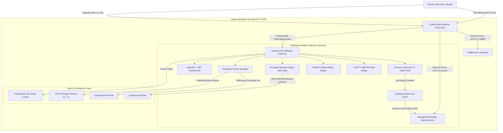

# System Architecture Specification: Ownbase Native Windows Server

**Document Version:** 1.0.0  
**Status:** Approved Architectural Baseline  
**Target:** Native Windows Server Orchestration without Virtualization (Docker/WSL2)

---

## 1. Architectural Philosophy & Design Principles

Ownbase is engineered to transform any Windows 10, Windows 11, or Windows Server host into a resilient, enterprise-grade cloud server appliance without relying on Docker Desktop, Hyper-V, or WSL2.

### Core Tenets:
1. **Bare-Metal Win32 Efficiency:** Run services directly on Windows kernel primitives (Job Objects, NTFS, Win32 Sockets, Windows Services) to eliminate the 1.5–2.0 GB RAM overhead of Linux virtualization.
2. **Strict Loopback Ingress (P2):** Backend workloads bind exclusively to `127.0.0.1`. The Caddy Edge Reverse Proxy is the sole public/LAN entry point on ports 80 and 443.
3. **Defense-in-Depth Isolation:** Process sandboxing via Windows Job Objects (`JOBOBJECT_EXTENDED_LIMIT_INFORMATION`), filesystem confinement via `PathGuard`, and encrypted secret storage via Windows DPAPI.
4. **Resilient 24/7 Operations:** Automatic delayed-auto start at Windows boot before user login; formal 7-state supervisory state machine with exponential backoff and circuit breakers.
5. **Contract-Driven Design:** Every endpoint, schema, and RBAC role is defined in a centralized contract (`src/shared/contract/`), driving automated OpenAPI 3.0 generation and runtime validation.

---

## 2. System Architecture Diagram

---

## 3. Subsystem Breakdown

### 3.1. Headless Background Service (`src/daemon/main.ts`)
- **Execution Model:** Runs as a standard Windows Service managed by WinSW (`ownbase-service.exe`) or `sc.exe`.
- **Identity:** Runs under the virtual service account `NT SERVICE\Ownbase` with bounded filesystem ACLs on `%ProgramData%\Ownbase`.
- **Zero-Electron Enforcement:** The entire daemon is 100% decoupled from Electron, enabling server-grade operation without any display server, GPU, or active user desktop session.

### 3.2. Process Supervisor & Windows Job Objects (`src/daemon/supervisor/`)
- **State Machine:** Enforces valid state transitions across 7 formal states: `stopped`, `starting`, `running`, `stopping`, `crashed`, `backoff`, `failed`.
- **Process Launcher (`tools/jobhost/Program.cs`):** Spawns child workloads inside a dedicated Windows Job Object with:
  - `JOB_OBJECT_LIMIT_PROCESS_MEMORY`: Hard commit limits (e.g. 512 MB).
  - `JOB_OBJECT_CPU_RATE_CONTROL_ENABLE`: Hard CPU percentage caps (e.g. 50%).
  - `JOB_OBJECT_LIMIT_KILL_ON_JOB_CLOSE`: Prevents orphaned zombie processes upon daemon restart.
- **Circuit Breaker:** Detects rapid crash loops (3 crashes in 60s); transitions service to `failed` and trips circuit breaker to prevent host resource starvation.

### 3.3. Database & Additive Schema Engine (`src/daemon/db/`)
- **Engine:** Bundled native PostgreSQL 16 binary cluster.
- **Port Management:** Listens strictly on loopback port `5432`.
- **Stale Lock Recovery (P6 & D6):** Probes the Windows process table for active `postgres.exe` PIDs before unlinking stale `postmaster.pid` locks after unexpected host reboots.
- **Schema Management:** Prisma ORM with additive migrations (`prisma migrate deploy`). No destructive schema changes in production.

### 3.4. Edge Network Ingress & Caddy Proxy (`src/daemon/network/`)
- **Inbound Access:** Only ports 80 and 443 permitted in Windows Firewall (Private profile).
- **Dynamic Configuration:** Automatically generates Caddy JSON/Caddyfile configurations with active upstream health checks.
- **Tailscale Mesh Integration:** Automatic detection of Tailscale mesh IP (`100.x.y.z`) and MagicDNS domain name with automatic Let's Encrypt / Tailscale ACME TLS certificates.
- **Forward Authentication:** Enforces authentication on all external LAN routes before allowing traffic to hit private services.

### 3.5. Storage & Contained File Streaming (`src/daemon/files/` & `storage/`)
- **Volume Discovery:** Native PowerShell `Get-Volume` enumeration persisting volume metadata (drive letter, label, filesystem, total bytes, free bytes) to PostgreSQL.
- **PathGuard Confinement (P4):** Resolves canonical paths (`fs.realpathSync`), strictly forbids Alternate Data Streams (`:`), directory traversals (`..`), and drive specifiers outside declared root folders.
- **Streaming Upload Engine (P12):** Streams multi-gigabyte uploads directly to temporary disk files with atomic rename upon checksum validation, maintaining an RSS footprint under 100 MB.
- **RFC 7233 Range Streaming (P13):** Supports partial content requests, suffix ranges (`bytes=-500`), and RFC 5987 unicode filenames for smooth media streaming.

### 3.6. Disaster Recovery & Observability Engine (`src/daemon/backup/` & `observability/`)
- **Encrypted Archives:** Bundles database table dumps, system configurations, and AES-256 encrypted master data keys into `.ownbase.bak` files protected by SHA-256 checksums.
- **Deep Health Probes:** Evaluates end-to-end component health (Postgres `SELECT 1`, Caddy TCP 80, Supervisor, Volumes, Tailscale).
- **Telemetry & Alert Rules:** Continuous CPU, RAM, and volume capacity sampling with webhook notifications for disk capacity exhaustion (>90%) or service failures.
