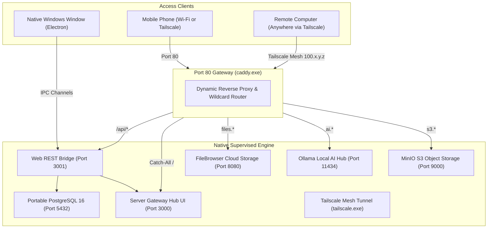

# Native Windows Server Hub 🚀

> **Transform any standard Windows 10/11 PC or laptop into a fully functional, 24/7 accessible server (VPS equivalent) using native Windows executables — without Docker, WSL2, or Hyper-V.**

---

## 🌟 Overview

**Native Windows Server Hub** is a standalone server orchestration platform inspired by modern server panels (like 1Panel, CasaOS, and Coolify), designed natively for Windows. 

Instead of requiring resource-heavy Linux virtual machines, Docker Desktop licensing, or WSL2 virtualization layers, Native Windows Server Hub orchestrates **100% native Windows executables** directly on bare metal. It pairs an embedded **PostgreSQL 16** database with a resilient **Process Supervisor**, dynamic **Caddy Reverse Proxy**, and **Tailscale WireGuard Mesh VPN**, all controllable via a desktop UI or remotely from any browser on phone, tablet, or another computer.

---

## 🏗️ Architecture



---

## ✨ Key Features

- **Zero Virtualization Overhead:** Runs directly on Windows 10/11 without WSL2, Docker Desktop, or Hyper-V. Saves gigabytes of RAM and starts in under 2 seconds.
- **Embedded Portable PostgreSQL 16:** Automatically initializes a standalone database cluster (`initdb`), runs as a silent native engine on port `5432`, and executes automated Prisma ORM migrations (`prisma migrate deploy`). Includes an interactive SQL query runner.
- **Robust Native Process Supervisor:** Spawns, monitors, restarts, and streams live console logs for Windows executables. Eliminates zombie processes on app exit using tree termination (`taskkill /PID <PID> /T /F`).
- **Dynamic Caddy Reverse Proxy:** Zero-downtime, zero-config route registration via Caddy's Admin REST API (port `2019`). Automatically maps subdomains and wildcard domains (`*.nip.io` / `*.sslip.io`) without editing hosts files.
- **Tailscale Mesh VPN Integration:** Access your home/office Windows server from anywhere in the world across cellular data or coffee shop Wi-Fi without router port forwarding or public static IPs.
- **Universal Remote Web Management:** Built-in Web REST API bridge (`:3001`) lets you manage services, check server metrics, and view logs from your phone or tablet just like 1Panel.
- **24/7 Server Persistence & Power Lock:** Integrates Windows System Tray minimization, automatic startup on Windows boot (`app.setLoginItemSettings`), and power suspension blocker (`powerSaveBlocker.start('prevent-app-suspension')`) so your server keeps running with the laptop lid closed.
- **1-Click App Store:** Provision native services with automatic route configuration in seconds.

---

## 📦 Included Supervised Services

| Service | Executable | Port | Local Subdomain | Wi-Fi / Remote URL | Description | Default Credentials |
| :--- | :--- | :--- | :--- | :--- | :--- | :--- |
| **Server Gateway Hub** | `Next.js / Electron` | `3000` | `http://localhost/` | `http://<IP>/` | Central 1Panel-inspired management dashboard | N/A (Desktop / Local) |
| **Caddy Reverse Proxy** | `caddy.exe` | `80`, `2019` | `proxy.localhost` | `http://<IP>/` | Dynamic reverse proxy & Admin REST API | N/A |
| **PostgreSQL 16** | `postgres.exe` | `5432` | `localhost:5432` | `postgres://localhost:5432` | Portable relational database cluster | `postgres` (No password) |
| **FileBrowser** | `filebrowser.exe` | `8080` | `files.localhost` | `http://files.<IP>.nip.io` | High-performance private cloud drive | `admin` / `admin12345678` |
| **Ollama AI Hub** | `ollama.exe` | `11434` | `ai.localhost` | `http://ai.<IP>.nip.io` | Local LLM inference server (OpenAI-compatible) | Open API |
| **MinIO S3 Storage** | `minio.exe` | `9000` | `s3.localhost` | `http://s3.<IP>.nip.io` | S3-compatible cloud object storage & web console | `admin` / `admin12345678` |
| **Tailscale VPN** | `tailscale.exe` | N/A | Mesh Overlay | `http://<Tailscale-IP>/` | Encrypted WireGuard overlay tunnel | Auth Key via UI |

---

## 🌐 Network & Remote Access Guide

### 1. From the Host Laptop/PC
- Open the desktop Electron application, or navigate to:
  - **Server Gateway Hub:** `http://localhost/` or `http://localhost:3000`
  - **File Storage:** `http://files.localhost`
  - **AI Engine:** `http://ai.localhost`
  - **MinIO S3:** `http://s3.localhost`

### 2. From Other Devices on Local Wi-Fi (Phones, Tablets, Laptops)
The server automatically detects your LAN IP (e.g., `192.168.0.108`) and configures wildcard DNS (`nip.io`):
- **Server Gateway Hub Dashboard:** `http://192.168.0.108/`
- **FileBrowser Cloud Drive:** `http://files.192.168.0.108.nip.io` or `http://192.168.0.108:8080`
- **Hermes 3 AI Chat Hub:** `http://ai.192.168.0.108.nip.io` or `http://192.168.0.108:11434`
- **MinIO S3 Console:** `http://s3.192.168.0.108.nip.io` or `http://192.168.0.108:9000`

### 3. Remote Access from Anywhere in the World (Tailscale Mesh VPN)
Connect to your Tailscale network using the Auth Key in the UI. Your server receives a WireGuard mesh IP (e.g., `100.84.32.40`):
- **Remote Gateway Hub:** `http://100.84.32.40/`
- **Remote File Storage:** `http://files.100.84.32.40.nip.io` or `http://100.84.32.40:8080`
- **Remote AI Chat:** `http://ai.100.84.32.40.nip.io` or `http://100.84.32.40:11434`
- **Remote S3 Storage:** `http://s3.100.84.32.40.nip.io` or `http://100.84.32.40:9000`

---

## 🛡️ Windows Defender Firewall Setup

To allow incoming traffic from mobile devices or other computers on your Wi-Fi, run the following **one-time command** in **PowerShell as Administrator**:

```powershell
New-NetFirewallRule -DisplayName "Windows Server Hub" -Direction Inbound -LocalPort 80,443,2019,3000,3001,8080,9000,11434,5432 -Protocol TCP -Action Allow
```

*(You can also copy this command with a single click inside the dashboard's Network Access card).*

---

## 🚀 Quickstart & Development

### Prerequisites
- **Operating System:** Windows 10 or Windows 11 (64-bit)
- **Node.js:** v18.0.0 or later
- **PowerShell:** Default on Windows

### Installation

1. **Clone repository:**
   ```powershell
   git clone https://github.com/rhmunna143/native-windows-server-prototype.git
   cd native-windows-server-prototype
   ```

2. **Install dependencies:**
   ```powershell
   npm install
   ```

3. **Bootstrap PostgreSQL distribution:**
   ```powershell
   npm run setup:postgres
   ```

4. **Launch development environment:**
   ```powershell
   npm run dev
   ```
   *This starts Next.js on port 3000 and launches the Electron desktop shell with active IPC channels.*

---

## 🔨 Available Scripts

| Command | Description |
| :--- | :--- |
| `npm run dev` | Concurrently runs Next.js dev server (`:3000`) and launches Electron shell |
| `npm run build` | Compiles Next.js static export and builds Electron main process TypeScript |
| `npm run build:next` | Generates optimized Next.js static bundle (`out/`) |
| `npm run build:electron` | Compiles TypeScript files in `src/main` into `dist/electron/main/` |
| `npm run start` | Compiles TypeScript and runs standalone Electron in production mode |
| `npm run compile:minio` | Compiles native `scripts/minio_server.cs` into `extraResources/bin/minio.exe` via C# compiler |
| `npm run setup:postgres` | Downloads and unpacks portable PostgreSQL 16 into `extraResources/pgsql` |
| `npm run prisma:generate` | Regenerates Prisma Client models |
| `npm run prisma:deploy` | Deploys pending Prisma database migrations to PostgreSQL |
| `npm run dist:dir` | Builds unpacked Windows application directory (`dist/release/win-unpacked`) |
| `npm run build:installer` | Creates standalone Windows setup wizard installer (`dist/release/*.exe`) |
| `npm run build:portable` | Creates standalone single-file portable Windows executable (`dist/release/*-Portable-*.exe`) |
| `npm run build:all` | Compiles both the NSIS installer and portable `.exe` in one pass |

---

## 📦 Packaging & Building Executables (.exe)

Native Windows Server Hub provides dedicated build scripts to generate both **portable** and **installable** 64-bit Windows executables with all native services bundled (`caddy.exe`, `filebrowser.exe`, `minio.exe`, `ollama.exe`, `tailscale.exe`, and portable `PostgreSQL 16`).

### 1. Standalone Portable Executable (`.exe`)
The portable executable runs immediately from any folder, USB flash drive, or desktop without installation, registry modification, or administrator privileges:
- **Batch Script (CMD / Explorer double-click):**
  ```cmd
  .\build-portable.bat
  ```
- **PowerShell Script:**
  ```powershell
  .\build-portable.ps1
  ```
- **NPM Command:**
  ```powershell
  npm run build:portable
  ```
- **Output Artifact:**
  `dist\release\Native Windows Server Hub-Portable-0.1.0.exe`

### 2. Windows NSIS Setup Installer (`.exe`)
The installable setup wizard installs the application into `Program Files` or a custom directory, creates Desktop and Start Menu shortcuts, and provides clean uninstallation:
- **Batch Script (CMD / Explorer double-click):**
  ```cmd
  .\build-installer.bat
  ```
- **PowerShell Script:**
  ```powershell
  .\build-installer.ps1
  ```
- **NPM Command:**
  ```powershell
  npm run build:installer
  ```
- **Output Artifact:**
  `dist\release\Native Windows Server Hub-Setup-0.1.0.exe`

### 3. Build Both Simultaneously
To compile both portable and installer packages in a single run:
```cmd
.\build-all.bat
# or in PowerShell:
.\build-all.ps1
# or via npm:
npm run build:all
```

---

## 📁 Project Structure

```
native-windows-server-prototype/
├── extraResources/               # Native Windows binaries bundled with app
│   ├── bin/
│   │   ├── caddy.exe            # Caddy 2 reverse proxy
│   │   ├── filebrowser.exe      # FileBrowser cloud storage engine
│   │   ├── minio.exe            # Native MinIO S3 server
│   │   ├── ollama.exe           # Local AI inference server
│   │   └── tailscale.exe        # Tailscale CLI wrapper
│   └── pgsql/                   # Portable PostgreSQL 16 binary distribution
│       └── bin/
│           ├── initdb.exe
│           ├── postgres.exe
│           └── pg_ctl.exe
├── prisma/
│   └── schema/                  # Multi-file Prisma schemas
│       ├── schema.prisma
│       ├── service.prisma
│       └── route.prisma
├── scripts/
│   ├── minio_server.cs          # Standalone native C# S3 & Web console source
│   ├── setup-postgres.js        # Automated PostgreSQL downloader & unpacker
│   └── sync_caddy.js            # Caddy route synchronization script
├── src/
│   ├── app/                     # Next.js 14 App Router UI
│   │   ├── globals.css
│   │   ├── layout.tsx
│   │   └── page.tsx             # 1Panel-inspired Dashboard UI
│   ├── components/              # React UI components
│   │   ├── AppStore.tsx         # 1-Click native app installer
│   │   ├── BootstrapStepper.tsx # Startup architecture visualizer
│   │   ├── DatabaseCard.tsx     # PostgreSQL monitor & SQL query runner
│   │   ├── DiagnosticsCard.tsx  # 1-Click system verification
│   │   ├── Header.tsx           # Server KPIs & LAN badge
│   │   ├── LifecycleCard.tsx    # 24/7 Power blocker & tray controls
│   │   ├── LogViewer.tsx        # Real-time console log streamer
│   │   ├── NetworkAccessCard.tsx# Wi-Fi & Tailscale remote links
│   │   ├── RoutesTable.tsx      # Caddy domains & TLS manager
│   │   └── ServicesTable.tsx    # Process supervisor controls
│   ├── main/                    # Electron main process (Node.js engine)
│   │   ├── caddy.ts             # Dynamic Caddy Admin REST API manager
│   │   ├── httpServer.ts        # Native Web REST API bridge (:3001)
│   │   ├── index.ts             # Electron entrypoint & startup orchestrator
│   │   ├── ipc.ts               # Electron IPC channels
│   │   ├── lifecycle.ts         # System tray & Windows power blocker
│   │   ├── logger.ts            # Centralized logger
│   │   ├── postgres.ts          # Portable PostgreSQL supervisor
│   │   ├── prisma.ts            # Database migration executor
│   │   ├── supervisor.ts        # Native process supervisor (child_process)
│   │   └── tailscale.ts         # Tailscale mesh VPN manager
│   └── shared/
│       ├── apiClient.ts         # Universal API client (IPC + HTTP REST)
│       └── types.ts             # TypeScript definitions
├── electron-builder.yml         # Windows installer packaging config
├── package.json
└── tsconfig.json
```

---

## 🛠️ Technology Stack

- **Desktop Shell:** [Electron 32](https://www.electronjs.org/)
- **Frontend Framework:** [Next.js 14](https://nextjs.org/) (Static Export)
- **Styling & UI:** [Tailwind CSS](https://tailwindcss.com/), [Lucide React](https://lucide.dev/)
- **Data Layer:** [Prisma ORM 6](https://www.prisma.io/), [PostgreSQL 16](https://www.postgresql.org/)
- **Reverse Proxy:** [Caddy Server 2.8](https://caddyserver.com/)
- **Mesh VPN:** [Tailscale WireGuard](https://tailscale.com/)
- **Native Packaging:** [electron-builder](https://www.electron.build/) (NSIS x64)

---

## 💡 Troubleshooting & FAQ

### 1. "MinIO or FileBrowser fails to start with port conflict"
Ensure no other software is using port `8080`, `9000`, or `11434`. You can inspect listening ports in PowerShell with:
```powershell
Get-NetTCPConnection -LocalPort 80, 8080, 9000, 11434, 5432 -ErrorAction SilentlyContinue | Select-Object LocalAddress, LocalPort, State, OwningProcess
```

### 2. "Other devices on Wi-Fi cannot open the dashboard"
1. Verify both devices are on the **same Wi-Fi network**.
2. Run the Windows Defender Firewall inbound rule command above.
3. Use the exact LAN IP shown in the header badge (e.g. `http://192.168.0.108/`).

### 3. "How to keep the server running when closing the laptop lid"
1. In Windows, open **Control Panel → Power Options → Choose what closing the lid does**.
2. Set **When I close the lid:** to **Do nothing** (for both On battery and Plugged in).
3. The application will automatically engage `powerSaveBlocker` (`prevent-app-suspension`), preventing Windows from suspending background services or turning off network adapters.

---

## 📄 License

This project is licensed under the [MIT License](LICENSE).
