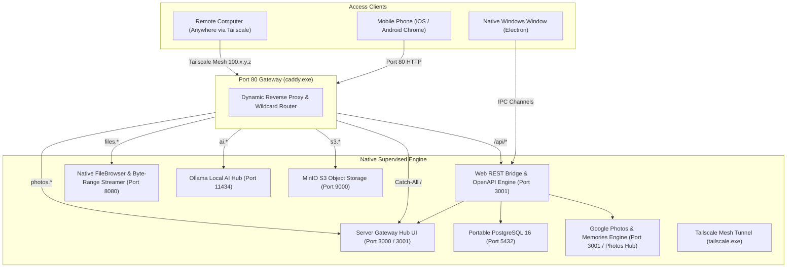

# Native Windows Server Hub 🚀

> **Transform any standard Windows 10/11 PC or laptop into a fully functional, 24/7 accessible server (VPS equivalent) using native Windows executables — without Docker, WSL2, or Hyper-V.**

---

## 🌟 Overview

**Native Windows Server Hub** is a standalone server orchestration platform inspired by modern server panels (like 1Panel, CasaOS, and Coolify), designed specifically and natively for Windows. 

Instead of requiring resource-heavy Linux virtual machines, Docker Desktop licensing, or WSL2 virtualization layers, Native Windows Server Hub orchestrates **100% native Windows executables** directly on bare metal. It pairs an embedded **PostgreSQL 16** database with a resilient **Process Supervisor**, dynamic **Caddy Reverse Proxy**, and **Tailscale WireGuard Mesh VPN**, all controllable via a desktop UI or remotely from any browser on phone, tablet, or another computer.

---

## 🏗️ Architecture



---

## ✨ Key Features

- **Zero Virtualization Overhead:** Runs directly on Windows 10/11 without WSL2, Docker Desktop, or Hyper-V. Saves gigabytes of RAM and boots in under 2 seconds.
- **100% Mobile-Friendly & Responsive UI:** Sleek mobile-first interface featuring a slide-out drawer, bottom navigation bar (`[Home] [Files] [Photos] [Apps] [APIs]`), and touch-optimized controls for phones (iOS/Android) and tablets.
- **Native File Explorer & High-Performance Media Streaming:** 
  - Interactive file browser with 1-tap folder navigation, multi-file uploads, and instant search.
  - **HTTP 206 Partial Content (Byte-Range requests)** streaming engine for playing multi-gigabyte 1080p/4K `.mkv`, `.mp4`, `.webm`, and `.mov` videos smoothly on mobile phones without buffering or downloading the entire file.
- **Google Photos & Memories Gallery Service:** 
  - Chronological photo and video timeline sections ("Today", "Yesterday", "October 2026").
  - 1-tap direct camera roll uploads from smartphones.
  - Category filters (*All*, *Photos*, *Videos*, *Favorites*).
  - Full-screen interactive lightbox modal with swipe/arrow controls and favorite starring.
- **Universal REST APIs & OpenAPI 3.0 Specification:** 
  - Complete documented REST endpoints for every subsystem (Files, Byte-Range Streaming, Photos, Database, Caddy, Supervisor, Tailscale).
  - Built-in interactive **API Documentation & Test Runner** tab with live execution and 1-click cURL copying.
  - Full machine-readable OpenAPI 3.0 spec at `GET /api/openapi.json`.
  - Comprehensive external guide in [API_DOCUMENTATION.md](API_DOCUMENTATION.md) with Dart/Flutter, Swift, and cURL examples.
- **Windows Defender Smart App Control (SAC) Hardened Architecture:**
  - Services (`filebrowser.exe`, `minio.exe`, `ollama.exe`) are compiled natively on the machine via Microsoft's built-in `csc.exe` (.NET Framework), ensuring full execution trust without Windows Application Control (`spawn UNKNOWN`) blocks.
- **Embedded Portable PostgreSQL 16:** 
  - Automatically initializes a standalone database cluster (`initdb`), runs as a silent native engine on port `5432`, and executes automated Prisma ORM migrations (`prisma migrate deploy`). Includes an interactive SQL query runner.
- **Robust Native Process Supervisor:** 
  - Spawns, monitors, auto-restarts, and streams live console logs for Windows executables. Eliminates zombie processes on app exit using tree termination (`taskkill /PID <PID> /T /F`).
- **Dynamic Caddy Reverse Proxy:** 
  - Zero-downtime, zero-config route registration via Caddy's Admin REST API (port `2019`). Automatically maps subdomains and wildcard domains (`*.nip.io` / `*.sslip.io`) without editing hosts files.
- **Tailscale Mesh VPN Integration:** 
  - Access your home/office Windows server from anywhere in the world across cellular data or coffee shop Wi-Fi without router port forwarding or public static IPs.
- **24/7 Server Persistence & Power Lock:** 
  - Integrates Windows System Tray minimization, automatic startup on Windows boot (`app.setLoginItemSettings`), and power suspension blocker (`powerSaveBlocker.start('prevent-app-suspension')`) so your server keeps running with the laptop lid closed.
- **1-Click App Store:** Provision native services with automatic route configuration in seconds.

---

## 📦 Included Supervised Services

| Service | Executable | Port | Local Subdomain | Wi-Fi / Remote URL | Description | Default Credentials |
| :--- | :--- | :--- | :--- | :--- | :--- | :--- |
| **Server Gateway Hub** | `Daemon / Gateway` | `3001` (Loopback) | `http://localhost/` | `http://<IP>/` | Central management dashboard & mobile shell (proxied via Caddy :80/:443) | User Login / RBAC |
| **Caddy Reverse Proxy** | `caddy.exe` | `80`, `443` | `proxy.localhost` | `http://<IP>/` | Sole external ingress listener & TLS reverse proxy | N/A |
| **FileBrowser Storage** | `filebrowser.exe` | `8080` (Loopback) | `files.localhost` | `http://files.<IP>.nip.io` | Native cloud drive with HTTP 206 byte-range streaming engine | Authenticated Session |
| **Google Photos Hub** | `Web API Engine` | `3001` (Loopback) | `photos.localhost` | `http://photos.<IP>.nip.io` | Timeline photo/video gallery, favorites & camera backup | Authenticated Session |
| **PostgreSQL 16** | `postgres.exe` | `5432` (Loopback) | `127.0.0.1:5432` | N/A (Internal) | Hardened relational database cluster (`scram-sha-256`, loopback-only) | Generated scram-sha-256 |
| **Ollama AI Hub** | `ollama.exe` | `11434` (Loopback) | `ai.localhost` | `http://ai.<IP>.nip.io` | Local LLM inference server (Hermes 3, Llama 3) | Internal Proxy |
| **MinIO S3 Storage** | `minio.exe` | `9000` (Loopback) | `s3.localhost` | `http://s3.<IP>.nip.io` | S3-compatible cloud object storage & web console | Generated Credentials |
| **Tailscale VPN** | `tailscale.exe` | N/A | Mesh Overlay | `http://<Tailscale-IP>/` | Encrypted WireGuard overlay tunnel | Auth Key via UI |

---

## 🌐 Network & Remote Access Guide

### 1. From the Host Laptop/PC
- Open the desktop Electron application, or navigate to:
  - **Server Gateway Hub:** `http://localhost/` or `http://localhost:3000`
  - **File Storage & Media Streamer:** `http://files.localhost` or `http://127.0.0.1:8080`
  - **Photos Gallery:** `http://photos.localhost`
  - **AI Engine:** `http://ai.localhost` or `http://127.0.0.1:11434`
  - **MinIO S3:** `http://s3.localhost` or `http://127.0.0.1:9000`

### 2. From Other Devices on Local Wi-Fi (Phones, Tablets, Laptops)
The server automatically detects your LAN IP (e.g., `192.168.0.108`) and configures wildcard DNS (`nip.io`):
- **Server Gateway Hub Dashboard:** `http://192.168.0.108/`
- **FileBrowser Cloud Drive:** `http://files.192.168.0.108.nip.io` or `http://192.168.0.108:8080`
- **Google Photos Timeline:** `http://photos.192.168.0.108.nip.io`
- **Hermes 3 AI Chat Hub:** `http://ai.192.168.0.108.nip.io` or `http://192.168.0.108:11434`
- **MinIO S3 Console:** `http://s3.192.168.0.108.nip.io` or `http://192.168.0.108:9000`

### 3. Remote Access from Anywhere in the World (Tailscale Mesh VPN)
Connect to your Tailscale network using the Auth Key in the UI. Your server receives a WireGuard mesh IP (e.g., `100.84.32.40`):
- **Remote Gateway Hub:** `http://100.84.32.40/`
- **Remote File Storage:** `http://files.100.84.32.40.nip.io` or `http://100.84.32.40:8080`
- **Remote Photos Gallery:** `http://photos.100.84.32.40.nip.io`
- **Remote AI Chat:** `http://ai.100.84.32.40.nip.io` or `http://100.84.32.40:11434`
- **Remote S3 Storage:** `http://s3.100.84.32.40.nip.io` or `http://100.84.32.40:9000`

---

## 📡 REST API & Developer Integration

Every capability of Native Windows Server Hub is exposed via REST endpoints so you can build custom mobile apps (Flutter, React Native, Swift), automation scripts, or IoT clients.

- **OpenAPI 3.0 Specification:** `GET /api/openapi.json`
- **Interactive Documentation Card:** Built directly into the dashboard navigation (`[APIs]` tab).
- **Comprehensive API Documentation:** Refer to [API_DOCUMENTATION.md](API_DOCUMENTATION.md) for endpoint specifications, request/response schemas, and ready-to-run Dart/Flutter, Swift, and cURL snippets.

### Key API Endpoints

| Category | Endpoint | Method | Description |
| :--- | :--- | :--- | :--- |
| **Files** | `/api/files` | `GET` | List files & directories in storage |
| **Streaming** | `/api/files/stream?path={path}` | `GET` | **RFC 7233 Byte-range streaming** for video/audio |
| **Upload** | `/api/files/upload` | `POST` | Upload files (multipart or octet-stream) |
| **Photos** | `/api/photos` | `GET` | Fetch timeline grouped photos & videos |
| **Favorites** | `/api/photos/favorite` | `POST` | Toggle favorite status on media |
| **Services** | `/api/services` | `GET` | Get all managed services & route configs |
| **Lifecycle** | `/api/services/{id}/start` | `POST` | Start / restart managed native process |
| **Proxy** | `/api/caddy/status` | `GET` | Check Caddy proxy & active routes |
| **Database** | `/api/database/query` | `POST` | Execute custom SQL against PostgreSQL 16 |
| **Tailscale** | `/api/tailscale/status` | `GET` | Retrieve Tailscale mesh VPN IP & peers |

---

## 🛡️ Windows Defender Firewall Setup (Decision D3)

In accordance with architectural Decision **D3**, the Ownbase backend daemon binds strictly to loopback (`127.0.0.1:3001`). Caddy on ports **80** and **443** is the **sole external listener**.

To allow incoming LAN or Wi-Fi traffic, create an inbound firewall rule allowing only ports 80 and 443 in **PowerShell as Administrator**:

```powershell
New-NetFirewallRule -DisplayName "Ownbase Ingress (HTTP/HTTPS)" -Direction Inbound -Profile Private -LocalPort 80,443 -Protocol TCP -Action Allow
```

> ⚠️ **Security Notice:** Do not open internal ports (3001, 5432, 8080, 9000, 11434) to the LAN. All external traffic is safely routed and authenticated through Caddy.

---

## 🚀 Quickstart & Development

### Prerequisites
- **Operating System:** Windows 10 or Windows 11 (64-bit)
- **Node.js:** v18.0.0 or later
- **PowerShell:** Default on Windows
- **Microsoft .NET Framework 4.0+:** Built-in on Windows 10/11 (`csc.exe`)

### Installation

1. **Clone repository:**
   ```powershell
   git clone https://github.com/rhmunna143/native-windows-server-prototype.git
   cd native-windows-server-prototype
   ```

2. **Install dependencies:**
   ```powershell
   npm install
   ```

3. **Bootstrap PostgreSQL distribution:**
   ```powershell
   npm run setup:postgres
   ```

4. **Compile native service binaries (SAC trusted):**
   ```powershell
   npm run compile:binaries
   ```

5. **Launch development environment:**
   ```powershell
   npm run dev
   ```
   *This starts Next.js on port 3000 and launches the Electron desktop shell with active IPC channels.*

---

## 🔨 Available Scripts

| Command | Description |
| :--- | :--- |
| `npm run dev` | Concurrently runs Next.js dev server (`:3000`) and launches Electron shell |
| `npm run build` | Compiles Next.js static export and builds Electron main process TypeScript |
| `npm run build:next` | Generates optimized Next.js static bundle (`out/`) |
| `npm run build:electron` | Compiles TypeScript files in `src/main` into `dist/electron/main/` |
| `npm run start` | Compiles TypeScript and runs standalone Electron in production mode |
| `npm run compile:filebrowser` | Compiles native `scripts/filebrowser_server.cs` into `extraResources/bin/filebrowser.exe` via `csc.exe` |
| `npm run compile:minio` | Compiles native `scripts/minio_server.cs` into `extraResources/bin/minio.exe` via `csc.exe` |
| `npm run compile:binaries` | Compiles both FileBrowser and MinIO native binaries in one command |
| `npm run setup:postgres` | Downloads and unpacks portable PostgreSQL 16 into `extraResources/pgsql` |
| `npm run prisma:generate` | Regenerates Prisma Client models |
| `npm run prisma:deploy` | Deploys pending Prisma database migrations to PostgreSQL |
| `npm run dist:dir` | Builds unpacked Windows application directory (`release/win-unpacked`) |
| `npm run build:installer` | Creates standalone Windows setup wizard installer (`release/*.exe`) |
| `npm run build:portable` | Creates standalone single-file portable Windows executable (`release/*-Portable-*.exe`) |
| `npm run build:all` | Compiles both the NSIS installer and portable `.exe` in one pass |

---

## 📦 Packaging & Building Executables (.exe)

Native Windows Server Hub provides dedicated build scripts to generate both **portable** and **installable** 64-bit Windows executables with all native services bundled (`caddy.exe`, `filebrowser.exe`, `minio.exe`, `ollama.exe`, `tailscale.exe`, and portable `PostgreSQL 16`). All output binaries are written directly to your `release/` directory.

### 1. Standalone Portable Executable (`.exe`)
The portable executable runs immediately from any folder, USB flash drive, or desktop without installation, registry modification, or administrator privileges:
- **Batch Script (CMD / Explorer double-click):**
  ```cmd
  .\build-portable.bat
  ```
- **PowerShell Script:**
  ```powershell
  .\build-portable.ps1
  ```
- **NPM Command:**
  ```powershell
  npm run build:portable
  ```
- **Output Artifact:**
  `release\Native Windows Server Hub-Portable-0.1.0.exe`

### 2. Windows NSIS Setup Installer (`.exe`)
The installable setup wizard installs the application into `Program Files` or a custom directory, creates Desktop and Start Menu shortcuts, and provides clean uninstallation:
- **Batch Script (CMD / Explorer double-click):**
  ```cmd
  .\build-installer.bat
  ```
- **PowerShell Script:**
  ```powershell
  .\build-installer.ps1
  ```
- **NPM Command:**
  ```powershell
  npm run build:installer
  ```
- **Output Artifact:**
  `release\Native Windows Server Hub-Setup-0.1.0.exe`

### 3. Build Both Simultaneously
To compile both portable and installer packages in a single run:
```cmd
.\build-all.bat
# or in PowerShell:
.\build-all.ps1
# or via npm:
npm run build:all
```

---

## 📁 Project Structure

```
native-windows-server-prototype/
├── API_DOCUMENTATION.md          # Comprehensive REST API guide with Flutter & Swift examples
├── extraResources/               # Native Windows binaries bundled with app
│   ├── bin/
│   │   ├── caddy.exe            # Caddy 2 reverse proxy
│   │   ├── filebrowser.exe      # Native FileBrowser & RFC 7233 byte-range streamer
│   │   ├── minio.exe            # Native MinIO S3 object storage server
│   │   ├── ollama.exe           # Local AI inference server
│   │   └── tailscale.exe        # Tailscale CLI wrapper
│   └── pgsql/                   # Portable PostgreSQL 16 binary distribution
│       └── bin/
│           ├── initdb.exe
│           ├── postgres.exe
│           └── pg_ctl.exe
├── prisma/
│   └── schema/                  # Multi-file Prisma schemas
│       ├── schema.prisma
│       ├── service.prisma
│       └── route.prisma
├── scripts/
│   ├── filebrowser_server.cs    # Standalone native C# FileBrowser & streaming source
│   ├── minio_server.cs          # Standalone native C# S3 & Web console source
│   ├── ollama_server.cs         # Standalone native C# AI Hub source
│   ├── setup-postgres.js        # Automated PostgreSQL downloader & unpacker
│   └── sync_caddy.js            # Caddy route synchronization script
├── src/
│   ├── app/                     # Next.js 14 App Router UI
│   │   ├── globals.css
│   │   ├── layout.tsx
│   │   └── page.tsx             # 1Panel-inspired Dashboard & Mobile Shell
│   ├── components/              # React UI components
│   │   ├── ApiDocsCard.tsx      # Interactive OpenAPI runner & cURL generator
│   │   ├── AppStore.tsx         # 1-Click native app installer
│   │   ├── BootstrapStepper.tsx # Startup architecture visualizer
│   │   ├── DatabaseCard.tsx     # PostgreSQL monitor & SQL query runner
│   │   ├── DiagnosticsCard.tsx  # 1-Click system verification
│   │   ├── FileBrowserCard.tsx  # Native Mobile-Responsive File Explorer & Video Player
│   │   ├── Header.tsx           # Server KPIs, LAN badge & Mobile Hamburger
│   │   ├── LifecycleCard.tsx    # 24/7 Power blocker & tray controls
│   │   ├── LogViewer.tsx        # Real-time console log streamer
│   │   ├── NetworkAccessCard.tsx# Wi-Fi & Tailscale remote links
│   │   ├── PhotosGalleryCard.tsx# Google Photos-style Timeline & Lightbox
│   │   ├── RoutesTable.tsx      # Caddy domains & TLS manager
│   │   └── ServicesTable.tsx    # Process supervisor controls
│   ├── main/                    # Electron main process (Node.js engine)
│   │   ├── caddy.ts             # Dynamic Caddy Admin REST API manager
│   │   ├── fileManager.ts       # Native File & Media Streaming backend (RFC 7233)
│   │   ├── httpServer.ts        # Native Web REST API bridge & static host (:3001)
│   │   ├── index.ts             # Electron entrypoint & startup orchestrator
│   │   ├── ipc.ts               # Electron IPC channels
│   │   ├── lifecycle.ts         # System tray & Windows power blocker
│   │   ├── logger.ts            # Centralized logger
│   │   ├── openApiSpec.ts       # Complete OpenAPI 3.0 specification definition
│   │   ├── postgres.ts          # Portable PostgreSQL supervisor
│   │   ├── prisma.ts            # Database migration executor
│   │   ├── supervisor.ts        # Native process supervisor (child_process)
│   │   └── tailscale.ts         # Tailscale mesh VPN manager
│   └── shared/
│       ├── apiClient.ts         # Universal API client (IPC + HTTP REST)
│       └── types.ts             # TypeScript definitions
├── electron-builder.yml         # Windows installer packaging config
├── package.json
└── tsconfig.json
```

---

## 🛠️ Technology Stack

- **Desktop Shell:** [Electron 32](https://www.electronjs.org/)
- **Frontend Framework:** [Next.js 14](https://nextjs.org/) (Static Export)
- **Styling & UI:** [Tailwind CSS](https://tailwindcss.com/), [Lucide React](https://lucide.dev/)
- **Media Streaming:** RFC 7233 HTTP 206 Partial Content Byte-Range Engine
- **Data Layer:** [Prisma ORM 6](https://www.prisma.io/), [PostgreSQL 16](https://www.postgresql.org/)
- **Reverse Proxy:** [Caddy Server 2.8](https://caddyserver.com/)
- **Mesh VPN:** [Tailscale WireGuard](https://tailscale.com/)
- **Native Packaging:** [electron-builder](https://www.electron.build/) (NSIS x64 & Portable)

---

## 💡 Troubleshooting & FAQ

### 1. "MinIO, FileBrowser, or Ollama gives an Application Control or spawn UNKNOWN error"
On Windows 11 with **Smart App Control (SAC)** enabled, external unsigned binaries are blocked by Windows security policies. Native Windows Server Hub solves this by compiling native C# implementations using Windows' built-in Microsoft compiler (`csc.exe`).
To recompile all binaries with 1 command:
```powershell
npm run compile:binaries
```

### 2. "Videos won't seek or play smoothly on mobile browsers"
Native Windows Server Hub features a built-in **RFC 7233 byte-range streaming engine**. Ensure you stream videos using:
- The embedded **File Explorer** card (`[Files]` tab in the dashboard).
- Direct stream URLs: `http://<IP>:3001/api/files/stream?path=<relPath>` or `http://files.<IP>.nip.io/api/stream?path=<relPath>`.

### 3. "Other devices on Wi-Fi cannot open the dashboard"
1. Verify both devices are on the **same Wi-Fi network**.
2. Run the Windows Defender Firewall inbound rule command above.
3. Use the exact LAN IP shown in the header badge (e.g. `http://192.168.0.108/`).

### 4. "How to keep the server running when closing the laptop lid"
1. In Windows, open **Control Panel → Power Options → Choose what closing the lid does**.
2. Set **When I close the lid:** to **Do nothing** (for both On battery and Plugged in).
3. The application will automatically engage `powerSaveBlocker` (`prevent-app-suspension`), preventing Windows from suspending background services or turning off network adapters.

---

## 📄 License

This project is licensed under the [MIT License](LICENSE).
