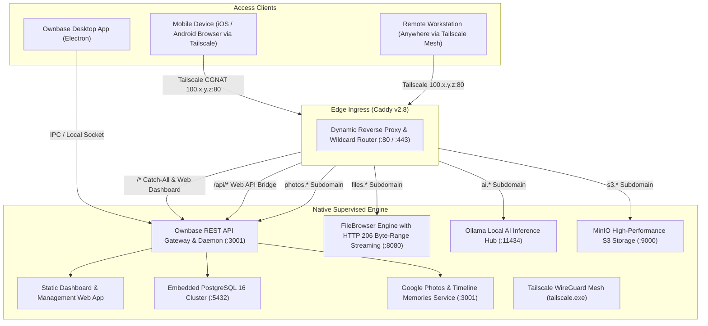

# Ownbase 🚀

> **Turn any standard Windows 10/11 PC or laptop into a private, 24/7 cloud server (VPS equivalent) using native Windows executables — without Docker, WSL2, or Hyper-V.**

[](package.json)
[]()
[]()
[](LICENSE.md)
[](https://rhmunna143.github.io/ownbase/)

---

## 🌟 Overview

**Ownbase** is a standalone, bare-metal server orchestration platform designed specifically and natively for Microsoft Windows. Inspired by modern server management hubs like 1Panel, CasaOS, and Coolify, Ownbase eliminates the massive CPU and RAM overhead of Linux virtual machines, Docker Desktop licensing, and WSL2 virtualization layers.

Instead, Ownbase runs **100% native Windows executables** directly on bare metal. It pairs an embedded **PostgreSQL 16** database with an intelligent **Process Supervisor**, dynamic **Caddy Reverse Proxy**, and **Tailscale WireGuard Mesh VPN**, all accessible locally through a modern desktop app or remotely via any web browser on your phone, tablet, or laptop.

---

## 🏗️ Architecture



---

## ✨ Key Features

- **Zero Virtualization Overhead**: Runs directly on bare-metal Windows 10/11 without WSL2, Docker Desktop, or Hyper-V. Saves gigabytes of RAM and boots in under 2 seconds.
- **Dual Distribution Modes**:
  - **NSIS Installer (`Ownbase-Setup-v*.exe`)**: Installs a resilient Windows Service (`NT SERVICE\Ownbase`), registers start menu shortcuts, and configures Windows Firewall automatically.
  - **Portable Executable (`Ownbase-Portable-v*.exe`)**: Zero installation required, registry-free, self-contained single `.exe` you can run from a USB drive or arbitrary directory.
- **Remote & Mobile Access over Tailscale VPN**: Securely connect to your home server from your phone or laptop on any cellular network or Wi-Fi without opening public router ports or needing a static IP.
- **Embedded PostgreSQL 16 Database**: Standalone database cluster automatically initialized (`initdb`) with `scram-sha-256` authentication, programmatic Prisma ORM migrations, and an interactive SQL query runner.
- **Dynamic Caddy Reverse Proxy**: Zero-downtime automatic subdomain routing (`files.*`, `photos.*`, `ai.*`, `s3.*`, `hub.*`) and wildcard DNS resolution (`*.nip.io` / `*.sslip.io`) without editing hosts files.
- **Native File Explorer & High-Performance Media Streaming**:
  - Folder navigation, drag-and-drop multi-file uploads, and instant search.
  - **HTTP 206 Partial Content (Byte-Range)** streaming engine for playing multi-gigabyte 1080p/4K video files (`.mkv`, `.mp4`, `.webm`, `.mov`) smoothly on mobile devices without buffering or downloading the entire file.
- **Google Photos & Memories Gallery**:
  - Chronological timeline view ("Today", "Yesterday", "October 2026").
  - 1-tap direct camera roll uploads from smartphones.
  - Full-screen lightbox preview with favorites starring.
- **Windows Power Persistence & System Tray**:
  - Automatically prevents Windows suspension or sleep (`powerSaveBlocker.start('prevent-app-suspension')`) so your server runs 24/7 even with laptop lids closed.
  - Minimizes seamlessly to the Windows notification tray.
- **Comprehensive "About" & System Diagnostics**: Instant access to application versioning, system hardware specs, developer contact, runtime engines, and diagnostic copying.
- **Universal REST APIs & OpenAPI 3.0**: Fully documented REST endpoints for every subsystem with interactive testing and live OpenAPI schema at `GET /api/openapi.json`.

---

## 📦 Supervised Native Services

| Service | Executable | Port | Local Address | Tailscale / Remote URL | Description | Default Auth |
| :--- | :--- | :--- | :--- | :--- | :--- | :--- |
| **Server Gateway Hub** | `Daemon / Gateway` | `3001` (Loopback) | `http://localhost/` | `http://100.x.y.z/` | Main control dashboard & management UI | User Session / RBAC |
| **Caddy Reverse Proxy** | `caddy.exe` | `80`, `443` | `proxy.localhost` | `http://100.x.y.z/` | External ingress listener & dynamic reverse proxy | N/A |
| **FileBrowser Storage** | `filebrowser.exe` | `8080` (Loopback) | `files.localhost` | `http://files.<IP>.nip.io` | Cloud drive with HTTP 206 byte-range streaming engine | Authenticated Session |
| **Google Photos Hub** | `Web API Engine` | `3001` (Loopback) | `photos.localhost` | `http://photos.<IP>.nip.io` | Timeline photo/video gallery, favorites & camera backup | Authenticated Session |
| **PostgreSQL 16** | `postgres.exe` | `5432` (Loopback) | `127.0.0.1:5432` | N/A (Internal) | Relational database cluster (`scram-sha-256`, loopback-only) | Generated SCRAM key |
| **Ollama AI Hub** | `ollama.exe` | `11434` (Loopback) | `ai.localhost` | `http://ai.<IP>.nip.io` | Local LLM inference server (Hermes 3, Llama 3) | Reverse Proxy Protected |
| **MinIO S3 Storage** | `minio.exe` | `9000` (Loopback) | `s3.localhost` | `http://s3.<IP>.nip.io` | High-speed Amazon S3-compatible object storage | Access Key / Secret Key |

---

## 🌐 Remote Access with Tailscale VPN

Access your Ownbase server securely from your iPhone, Android phone, or remote computer across any external network:

### 1. Connect Both Devices to Tailscale
- Install Tailscale on your Windows PC and sign in.
- Install the Tailscale app on your mobile device (App Store / Google Play) and sign in to the **same account**.

### 2. Configure Windows Defender Firewall
Windows classifies the Tailscale virtual adapter under the `Public` network profile. Allow inbound traffic from your private Tailscale mesh network by running PowerShell as Administrator:

```powershell
# Open PowerShell as Administrator:
New-NetFirewallRule -Name "Ownbase-Tailscale-Inbound" `
    -DisplayName "Ownbase Tailscale Remote Access" `
    -Description "Allows inbound web traffic from Tailscale WireGuard mesh devices (100.64.0.0/10)" `
    -Direction Inbound `
    -Protocol TCP `
    -LocalPort 80, 443, 3000, 3001, 8080 `
    -RemoteAddress 100.64.0.0/10 `
    -Action Allow `
    -Profile Any
```

### 3. Open the Dashboard on Mobile
1. Check your PC's Tailscale IPv4 address (starts with `100.x.y.z`, e.g. `100.85.12.34`).
2. Open your mobile browser and navigate directly to:
   ```text
   http://100.x.y.z/
   ```
3. Sign in to your Ownbase admin account to manage your files, photos, database, and services!

---

## 📥 Releases & Packaging

Release packages are generated into the `release/` directory with automatic version naming:

| Package Type | File Name | Description |
| :--- | :--- | :--- |
| **Windows Setup Installer** | `Ownbase-Setup-v<version>.exe` | NSIS wizard installer with background service setup, start menu shortcuts, and firewall rules. |
| **Standalone Portable** | `Ownbase-Portable-v<version>.exe` | Single self-contained binary. Run immediately with zero installation. |

### Build from Source
```bash
# 1. Clone repository
git clone https://github.com/rhmunna143/ownbase.git
cd ownbase

# 2. Install dependencies
npm install

# 3. Build Web Dashboard (Next.js export)
npm run build:next

# 4. Compile Electron Main Process
npm run build:electron

# 5. Package both Installer and Portable executables:
npm run dist:all
```

---

## 🔧 Troubleshooting

### 1. Mobile Tailscale Connection Timeout
- **Cause**: Windows Defender Firewall blocking port 80 on Public network profiles.
- **Fix**: Run the PowerShell firewall command detailed in the [Tailscale Setup](#-remote-access-with-tailscale-vpn) section with `-Profile Any`.

### 2. Portable Build "C:AppData/.../index.html, js not found"
- **Cause**: Next.js static HTML referencing absolute paths (`/_next/...`) loaded via Chromium's `file://` protocol.
- **Fix**: Ownbase serves static assets directly through its local gateway (`http://127.0.0.1:3001`), eliminating all drive root resolution errors.

---

## 👤 Developer & Maintainer

- **Lead Developer**: **rhmunna143**
- **Email**: [rhmunna19@gmail.com](mailto:rhmunna19@gmail.com)
- **Repository**: [https://github.com/rhmunna143/ownbase](https://github.com/rhmunna143/ownbase)
- **Online Documentation**: [https://rhmunna143.github.io/ownbase/](https://rhmunna143.github.io/ownbase/)

---

## 📄 License

This project is licensed under the [MIT License](LICENSE.md).
